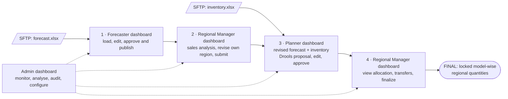
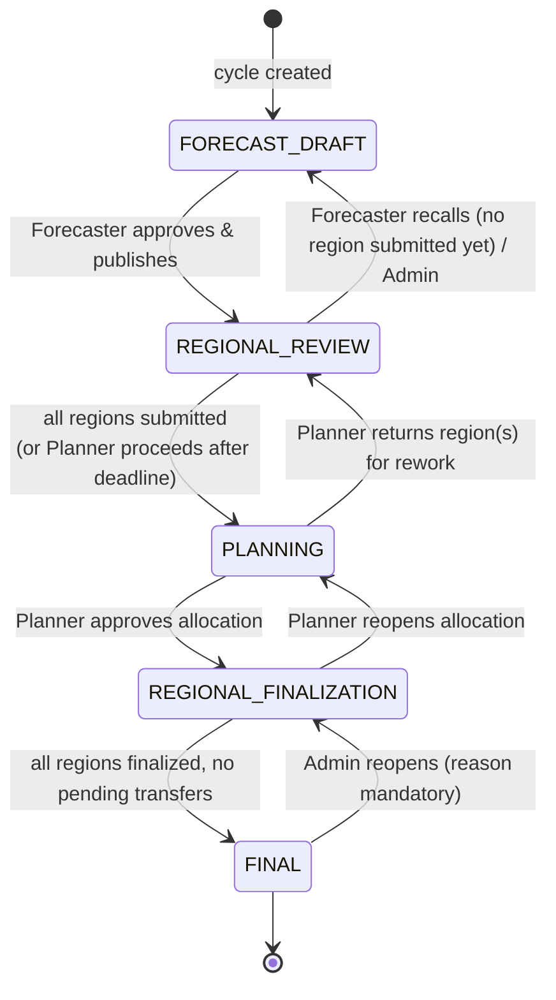

# PRD — Printer Inventory Forecasting & Regional Allocation (PIFA)

| | |
|---|---|
| **Document** | Product Requirements Document |
| **Product** | PIFA — Printer Inventory Forecasting & Regional Allocation platform |
| **Version** | 1.0 (draft for review) |
| **Date** | 21 Oct 2026 |
| **Related docs** | `architecture.md` (how it is built), `Phase.md` (how it is delivered) |
| **Status** | Draft — open questions in §14 need sign-off before Phase 1 |

---

## 1. Summary

PIFA replaces spreadsheet-and-email planning of monthly printer stock with one platform and **four role-based dashboards**: **Forecaster, Regional Manager, Planner and Admin**. Each month the platform:

1. Receives the **forecast Excel** and the **inventory Excel** (keyed by `Product_name`) through **SFTP**, validates them, and stores each file as a **new version**.
2. Lets the **Forecaster** review, adjust and **approve/publish** the forecast.
3. Lets each **Regional Manager** (North, East, West, South) revise their region's forecast using historical sales analysis, then submit it.
4. Shows the **Planner** the revised forecast next to inventory. The **Drools** rules engine proposes a model-wise allocation (**25% per region when stock is constrained**, full demand when stock is sufficient). The Planner adjusts and approves it.
5. Lets Regional Managers **rebalance**, adding units to one region by taking them from another, without changing the model total, and then **finalize**.
6. Gives **Admin** one place to analyse everything: forecasts, revisions, inventory, allocations, approvals, file versions and the full audit trail.

Users sign in through **Keycloak** (SSO, role-based access and region scoping). For now, the forecast, inventory and sales history are **synthetic data** produced by a generator that uses the same Excel templates and SFTP path as production, so the whole pipeline is tested before real data arrives.

---

## 2. Problem statement

- Forecasts may not match regional sales needs, and there is no structured way for regions to correct them.
- Limited inventory has to be shared across four regions, and there is no agreed, repeatable allocation rule.
- Separate manual updates (spreadsheets, emails) make it hard to track revisions, approvals and stock transfers. Totals drift, and no one can say who changed what or why.
- Files are passed around without version control, so teams plan against different copies.

## 3. Goals and non-goals

### 3.1 Goals

| # | Goal | Measure of success |
|---|---|---|
| G1 | One controlled monthly workflow from forecast to final allocation | 100% of cycles completed in PIFA; zero allocation spreadsheets exchanged by email |
| G2 | Fair, rule-based allocation of constrained stock | 100% of constrained models start from the Drools baseline; every deviation has a recorded reason |
| G3 | Reliable, versioned data intake | ≥ 99% of well-formed files appear in the dashboard ≤ 5 min after SFTP drop; every file is traceable to a version |
| G4 | Full traceability | 100% of edits, transfers, approvals, uploads and deletes appear in the audit log with user, time, old/new value and reason |
| G5 | Shorter planning cycle | Forecast publish → final allocation in ≤ 5 working days (baseline to be measured in pilot) |
| G6 | Totals can never exceed stock | 0 finalized allocations where Σ regions > allocatable stock (enforced by rules, not by user discipline) |

### 3.2 Non-goals (this release)

- Building a statistical forecasting model. The forecast arrives as an Excel file; PIFA manages it rather than generating it.
- Direct ERP/WMS integration. SFTP Excel is the integration contract for v1, and direct APIs are on the roadmap (`Phase.md`, Phase 7).
- Logistics execution (shipping, warehouse picking, purchase orders).
- Native mobile apps. The web UI is responsive and works on tablet.
- More than one allocation level (for example region → branch). The design keeps regions configurable, but v1 allocates to four regions only.

---

## 4. Users and roles

| Role | Who | Scope | Main jobs |
|---|---|---|---|
| **Forecaster** | Demand/forecasting analyst | All regions, forecast data | Load the forecast (SFTP or upload), correct it, approve and publish it to regions; manage forecast file versions |
| **Regional Manager (RM)** | One per region: North, East, West, South (a user may hold more than one region) | Edits **own region(s)** only; can view all regions read-only | Review historical sales, revise the forecast, submit it; review the allocation, request/accept transfers, finalize |
| **Planner** | Central supply/inventory planner | All regions, inventory and allocation | Load inventory (SFTP or upload), set reserve stock, run the Drools allocation, adjust and approve it, monitor finalization |
| **Admin** | Business/system administrator | Everything (read), configuration (write) | Analyse all data, manage master data, rule parameters, versions (delete/purge/restore), audit, cycles |
| **SFTP service accounts** | Upstream systems (forecast tool, ERP/WMS) | Write-only to their own SFTP inbound folder | Drop forecast/inventory Excel files |

Users, roles and region assignments are managed in **Keycloak** (see `architecture.md` §6).

---

## 5. Key concepts and glossary

| Term | Meaning |
|---|---|
| **Planning cycle** | One month of planning (for example `2026-11`). It moves through the workflow states in §7. |
| **Product / `Product_name`** | Printer model. `Product_name` is the join key between the forecast and inventory files. It is matched to the **product master** after normalization (trim, collapse spaces, case-insensitive) and an alias table. |
| **Region** | North, East, West, South (configurable master list). |
| **Uploaded forecast** | Quantities exactly as received in the active forecast file version. |
| **Published forecast** | The forecast after Forecaster edits, frozen when the Forecaster approves/publishes. |
| **Revised forecast (demand)** | The published forecast after Regional Manager edits, frozen at regional submission. |
| **Available stock** | `Available_Qty` from the active inventory file version. |
| **Reserve** | Units the Planner holds back (buffer, damaged, committed). Entered in the dashboard. |
| **Allocatable stock** | `Available − Reserve` for a model. |
| **Constrained model** | Total revised demand across all regions > allocatable stock. |
| **Proposed allocation** | What the Drools rules calculate. |
| **Approved allocation** | The proposal after Planner edits and approval. It is released to RMs. |
| **Final allocation** | The approved allocation after RM transfers, locked when all regions finalize. |
| **Transfer** | Moving N units of one model from a donor region to a receiving region. The model total does not change. |
| **Dataset version** | An immutable, numbered snapshot of data. It is created on every file ingestion and at every workflow sign-off (publish, submit, approve, finalize). |
| **Working copy** | The editable data a role is changing during its stage. Every cell change is logged. |

---

## 6. End-to-end workflow

| Step | Actor | What happens | Output version |
|---|---|---|---|
| 0 | SFTP / Forecaster / Planner | Forecast and inventory Excel files are ingested, validated and versioned | `FORECAST_UPLOAD vN`, `INVENTORY_UPLOAD vN` |
| 1 | Forecaster | Activates a forecast version, edits quantities if needed, then **approves and publishes** | `FORECAST_PUBLISHED` |
| 2 | Each RM | Reviews 12–24 months of sales history against the published forecast, edits own-region quantities (with a reason above the threshold) and **submits** | `FORECAST_REVISED` (one snapshot per region submit, plus a consolidated one when all four are in) |
| 3 | Planner | Sees revised demand + inventory, sets reserve, runs **Drools** allocation, adjusts and **approves** | `ALLOCATION_APPROVED` |
| 4 | Each RM | Sees the approved allocation for all regions, requests/accepts **transfers** and **finalizes** own region | `ALLOCATION_FINAL` when all four have finalized |
| — | Admin | Monitors and analyses every step; manages versions, rules and audit | — |

**Worked example (from the one-pager).** Printer Model A has 100 units available and is constrained. Drools proposes North 25, East 25, West 25, South 25. North and East agree a transfer of 5 units from East to North. The final allocation is North 30, East 20, West 25, South 25, and the total is still 100.

---

## 7. Cycle states and permissions per state

**Per-region sub-states.** In `REGIONAL_REVIEW` each region is `OPEN → SUBMITTED`; the Planner can return it to `OPEN`. In `REGIONAL_FINALIZATION` each region is `OPEN → FINALIZED`; an RM can un-finalize while the cycle is not `FINAL`.

Workflow transitions are enforced on the server. A transition only succeeds if its Drools guard rules pass (for example, "no pending transfers" before `FINAL`).

---

## 8. Data intake: SFTP Excel ingestion

### 8.1 Channels

| Channel | Use | Notes |
|---|---|---|
| **SFTP (primary)** | Scheduled system-to-system drops from the forecasting tool and ERP/WMS | Key-based service accounts, one inbound folder per data type |
| **Dashboard upload (secondary)** | Ad-hoc corrections by Forecaster (forecast) or Planner (inventory) | Goes through the same validation and versioning pipeline. Can be disabled by Admin. |
| **Synthetic generator (non-prod only)** | Generates realistic files and drops them in SFTP | Versions are tagged `SYNTHETIC`. Blocked in production. |

### 8.2 SFTP folder contract (folder → dashboard routing)

| SFTP path | Data type | Lands on | Allowed account |
|---|---|---|---|
| `/inbound/forecast/` | Forecast Excel | **Forecaster dashboard** (then flows to RM, Planner, Admin) | `sftp-forecast` |
| `/inbound/inventory/` | Inventory Excel | **Planner dashboard** (then flows to Admin) | `sftp-inventory` |
| `/outbound/errors/` | Error report for each rejected file (`<file>_errors.csv`) | Read by the source system | both (read-only) |

Rules for producers:

- Upload with a temporary name (`*.part`) and **rename to `*.xlsx` when complete**. Only `*.xlsx` files are picked up. `.xls`, `.xlsm` and `.csv` are rejected.
- Recommended file name: `FORECAST_<YYYY-MM>_<free-text>.xlsx` or `INVENTORY_<YYYY-MM-DD>_<free-text>.xlsx`. The file name is informational; **the cycle is taken from the file contents** (§8.3).
- Maximum file size: 10 MB. Maximum rows: 50,000.
- Picked-up files are removed from `/inbound` and archived in object storage. They are never processed twice (checked by content hash).

### 8.3 Excel templates (data contract)

Templates can be downloaded from each dashboard. The **first row is the header**. Column names are case-insensitive, and the column order does not matter.

**Forecast workbook**, sheet `Forecast`:

| Column | Required | Type / rule | Example |
|---|---|---|---|
| `Product_name` | Yes | Text ≤ 200 chars; must match the product master (after normalization or alias); unique within the file | `Mono Laser M100` |
| `Forecast_Month` | Yes | `YYYY-MM`; same value on every row; must be an existing cycle in `FORECAST_DRAFT` (or the next new cycle, which is auto-created if the Admin setting allows) | `2026-11` |
| `North` | Yes | Integer ≥ 0, ≤ 1,000,000 | `40` |
| `East` | Yes | as above | `35` |
| `West` | Yes | as above | `30` |
| `South` | Yes | as above | `25` |
| `Comments` | No | Text ≤ 500 chars | |

Region columns are driven by the region master, so adding a region adds a required column.

**Inventory workbook**, sheet `Inventory`:

| Column | Required | Type / rule | Example |
|---|---|---|---|
| `Product_name` | Yes | As for forecast; unique within the file | `Mono Laser M100` |
| `Available_Qty` | Yes | Integer ≥ 0 | `100` |
| `As_Of_Date` | Yes | Date (`YYYY-MM-DD` or an Excel date); same value on every row; not in the future | `2026-10-28` |
| `Planning_Month` | No | `YYYY-MM`. If blank, the file attaches to the single open cycle (not `FINAL`). It is required when more than one cycle is open. | `2026-11` |

### 8.4 Validation rules

Validation is **all-or-nothing**: if any row has an ERROR, the whole file is rejected and nothing is partly loaded. WARNINGs are shown but do not block.

| Code | Severity | Rule |
|---|---|---|
| `FILE_TYPE` | ERROR | Not a real `.xlsx` (checked by file signature), macro-enabled, password-protected or encrypted |
| `FILE_VIRUS` | ERROR | The antivirus scan failed |
| `SHEET_MISSING` | ERROR | Expected sheet (`Forecast` / `Inventory`) not found |
| `HEADER_MISSING` | ERROR | A required column is missing |
| `HEADER_UNKNOWN` | WARNING | An extra column was ignored |
| `PRODUCT_BLANK` | ERROR | `Product_name` is empty |
| `PRODUCT_UNKNOWN` | ERROR | `Product_name` is not in the product master or alias table. (Admin setting: queue for approval instead.) |
| `PRODUCT_DUPLICATE` | ERROR | The same product appears more than once in the file |
| `QTY_INVALID` | ERROR | Not an integer, negative, blank, above the maximum, or a formula with no cached value |
| `MONTH_MISMATCH` | ERROR | `Forecast_Month` differs between rows, or the cycle does not accept forecast uploads |
| `DATE_INVALID` | ERROR | `As_Of_Date` is missing, inconsistent or in the future |
| `DUPLICATE_FILE` | ERROR | A file with the same content hash was already ingested |
| `PRODUCT_NOT_IN_FILE` | WARNING | An active master product is missing from the file (treated as 0) |
| `QTY_SPIKE` | WARNING | Forecast for a product/region is more than 3× (configurable) its 6-month average sales |

The rejected file's **error report** (original rows plus an error column) can be downloaded in the dashboard. It is also written to SFTP `/outbound/errors/`. The uploader and Admin are notified.

### 8.5 Versioning

- **Every ingested file becomes a dataset version** of type `FORECAST_UPLOAD` or `INVENTORY_UPLOAD`. Versions are numbered per cycle (`FC-2026-11-v3`, `INV-2026-11-v2`) and store: source (SFTP/UI/SYNTHETIC), original file name, content hash, uploader or SFTP account, timestamp, row count, validation summary and status.
- **Every workflow sign-off creates an immutable snapshot version**: `FORECAST_PUBLISHED`, `FORECAST_REVISED`, `ALLOCATION_APPROVED`, `ALLOCATION_FINAL`.
- Version statuses: `RECEIVED → VALIDATING → VALID | REJECTED`; then `VALID → ACTIVE ↔ SUPERSEDED`; any version that is not locked can become `DELETED` (soft delete).
- **Only one ACTIVE version per type per cycle.**
  - Forecast: a new valid upload auto-activates while the cycle is in `FORECAST_DRAFT` (Admin setting; default on). Before it replaces the working copy, the current working copy (including Forecaster edits) is saved as a `FORECAST_WORKING_SNAPSHOT`, so no edit is lost. Forecast uploads that arrive after publish are stored as `VALID`, are not activated, and are flagged to the Forecaster.
  - Inventory: a new valid upload becomes ACTIVE in any state up to `PLANNING`. In `PLANNING` the Planner is told "inventory changed — re-run allocation". In `REGIONAL_FINALIZATION` or `FINAL` it is stored but not applied to the locked numbers, and the Admin dashboard flags "inventory changed after approval".
- **Compare** any two versions of the same type to see added or removed products and quantity differences by product and region.
- **Restore.** Create a new working copy from an older version. This is only possible while that data is still editable.

---

## 9. What can be changed in the dashboards

This is the editability matrix. Rules are enforced by the API and by Drools, not only by the UI. Each edit records user, timestamp, old value, new value and reason.

### 9.1 Data fields

| Data | Field | Forecaster | Regional Manager | Planner | Admin |
|---|---|---|---|---|---|
| Forecast | `Product_name`, `Forecast_Month` | Read only. To fix, upload a new version. | Read | Read | Read (product master maintained by Admin) |
| Forecast | Quantity per region (**published forecast**) | **Edit all regions** in `FORECAST_DRAFT` | Read | Read | Read |
| Forecast | Quantity, **own region** (**revised forecast**) | Read | **Edit own region** in `REGIONAL_REVIEW` while region is `OPEN`; **reason required** if change exceeds ±20% (configurable) | Read | Read |
| Forecast | Quantity, other regions (revised) | Read | Read | Read | Read |
| Forecast | Revision reason / comment | — | Edit (own region) | Read | Read |
| Inventory | `Product_name`, `Available_Qty`, `As_Of_Date` | Read | Read | Read only. To fix, upload a new version. | Read |
| Inventory | **Reserve qty** (per model) | Read | Read | **Edit** in `PLANNING`; reason required | Read |
| Allocation | Proposed allocation (Drools output) | — | — | Read; **Re-run** in `PLANNING` | Read |
| Allocation | **Approved allocation** per region | Read | Read | **Edit** in `PLANNING`; Σ regions ≤ allocatable per model | Read |
| Allocation | **Final allocation** per region | Read | **Change only through transfers** in `REGIONAL_FINALIZATION`; model total stays the same | Read; can accept/reject transfers on behalf of a region (escalation) | Read |
| Allocation | Transfer request | — | **Create** (from another region to own, or from own to another), **accept/reject** incoming, **cancel** own | Accept/reject (escalation) | Read |
| Config | Rule parameters (baseline split %, change threshold, minimum floor, spike factor, auto-activate) | — | — | Read | **Edit** (versioned, audited) |
| Config | Product master and aliases, region master | — | — | Read | **Edit** |
| Config | Users, roles, region assignment | — | — | — | In **Keycloak** |

Admin is read-only on business quantities by design, which keeps a clean separation of duties. Admin can **reopen** a cycle (with a reason) so that the owning role can make a correction.

### 9.2 Version and file actions (upload, download, delete)

| Action | Forecast upload versions | Inventory upload versions | Workflow snapshots | Notes |
|---|---|---|---|---|
| **Upload (UI)** | Forecaster | Planner | — (system-created) | SFTP accounts upload to their own folder only |
| **Download original file** (exact bytes received) | Forecaster, Planner, Admin | Planner, Forecaster, Admin | n/a | |
| **Download as Excel / CSV** (normalized, in template format so it can be re-uploaded) | Forecaster, Planner, Admin; RM (current view) | Planner, Admin; RM (current view, read-only data) | All roles that can view the data | Exports guard against formula injection and include a metadata sheet (version id, cycle, exported by, time) |
| **Download error report** | Forecaster, Admin | Planner, Admin | n/a | For rejected files |
| **Download blank template** | Forecaster, Admin | Planner, Admin | n/a | |
| **Compare versions** | Forecaster, Planner, Admin | Planner, Admin | All viewers | |
| **Activate / restore** | Forecaster (in `FORECAST_DRAFT`), Admin | Planner (up to `PLANNING`; triggers re-allocation prompt), Admin | Admin (via reopen) | Reason required |
| **Delete (soft)** | Forecaster: own uploads not used by a published forecast. Admin: any not locked | Planner: versions not used by an approved/final allocation. Admin: any not locked | **Not deletable** (audit evidence) | Reason required; the version is hidden from normal views but kept for audit |
| **Purge (hard delete)** | Admin, only for soft-deleted versions past the retention period, or synthetic data before go-live | same | Not allowed | Removes lines and raw file; leaves a tombstone audit entry |

Delete safeguards:

- The **ACTIVE** version cannot be deleted. Activate another version first, which avoids a cycle with no data by accident.
- A version **referenced by a published forecast, approved allocation or final allocation** cannot be deleted.
- Delete asks for confirmation and a reason, and writes an audit record. Deleted versions are listed under a "Show deleted" filter (Admin only) and can be **undeleted** until they are purged.

---

## 10. Functional requirements by dashboard

Priority: **M** = Must (v1 go-live), **S** = Should, **C** = Could.

### 10.1 Common (all dashboards)

| ID | Requirement | Pri |
|---|---|---|
| FR-COM-01 | Single sign-on through Keycloak; the landing page depends on role. A user with several roles can switch dashboards. | M |
| FR-COM-02 | Cycle selector (default: the current open cycle) and a status banner showing state, deadlines and per-region progress | M |
| FR-COM-03 | Grids support sort, filter, search by `Product_name`, column totals, frozen product column and pagination/virtual scroll for 10k products | M |
| FR-COM-04 | Editable cells are visually distinct. Changed cells are highlighted against the previous stage, with a tooltip for old value, who and when. | M |
| FR-COM-05 | Concurrent edits use optimistic locking. If someone else changed a row, the user sees the conflict and can refresh without losing the other edits. | M |
| FR-COM-06 | In-app notifications plus email for: publish, region submitted or returned, allocation approved, transfer requested/accepted/rejected, region finalized, cycle final, ingestion failed | M |
| FR-COM-07 | Every list and grid can be exported to Excel/CSV | M |
| FR-COM-08 | A "Synthetic data" banner appears whenever the data shown comes from synthetic versions | M |
| FR-COM-09 | Times are shown in the user's time zone (default IST) and stored in UTC | M |

### 10.2 Forecaster dashboard

| ID | Requirement | Pri |
|---|---|---|
| FR-FC-01 | **Ingestion panel**: latest SFTP pick-ups and their status (received, valid, rejected), error counts, links to error reports | M |
| FR-FC-02 | **Manual upload** of a forecast Excel (drag and drop) through the same pipeline; live validation result | M |
| FR-FC-03 | **Version history**: list of forecast versions (number, source, file name, uploader, time, rows, status, active flag) with **Download, Compare, Activate, Delete** | M |
| FR-FC-04 | **Forecast grid**: Product × North/East/West/South + Total; editable in `FORECAST_DRAFT`; difference from the uploaded file is shown | M |
| FR-FC-05 | Validation panel (Drools) listing blocking errors and warnings (for example spikes against sales history) | M |
| FR-FC-06 | **Approve & publish** with a comment. It is blocked while errors exist. It creates the `FORECAST_PUBLISHED` snapshot, opens `REGIONAL_REVIEW` and notifies RMs. | M |
| FR-FC-07 | **Recall** a published forecast while no region has submitted yet | S |
| FR-FC-08 | After publish, a read-only tracker of each region's revisions and submission status | S |
| FR-FC-09 | Set stage deadlines for regional review when publishing | S |

### 10.3 Regional Manager dashboard

| ID | Requirement | Pri |
|---|---|---|
| FR-RM-01 | **My tasks**: what needs action in each cycle (review forecast by date X, finalize allocation by date Y) | M |
| FR-RM-02 | **Forecast review grid**: product, published forecast (all regions read-only), **own-region revised qty (editable)**, change % and reason | M |
| FR-RM-03 | **Sales analysis** for each product in own region: last 3/6/12/24 months of sales, trend sparkline, same month last year, and published forecast against average sales, with drill-down chart | M |
| FR-RM-04 | Reason is mandatory when the change exceeds the threshold (Drools rule). Bulk edit (for example +10% on selected rows) uses the same rule. | M |
| FR-RM-05 | **Submit** revised forecast. This locks own-region edits and creates the regional `FORECAST_REVISED` snapshot. RMs can see when they have been returned by the Planner. | M |
| FR-RM-06 | **Allocation view** (in `REGIONAL_FINALIZATION`): for each product, own revised demand, approved allocation for **all four regions**, own fill rate (allocation ÷ demand), shortfall | M |
| FR-RM-07 | **Transfer requests**: request N units of a model from another region, or offer units to another region. Inbox to accept/reject incoming requests. Drools checks floor, donor quantity and model total before the request is created and again when it is accepted. | M |
| FR-RM-08 | **Finalize** own region. It is blocked while own region has pending transfers. Un-finalize is allowed until the cycle is `FINAL`. | M |
| FR-RM-09 | Download the own-region view (forecast, allocation) to Excel | M |
| FR-RM-10 | A user assigned to several regions can rebalance between their own regions directly, without a request and acceptance step | S |

### 10.4 Planner dashboard

| ID | Requirement | Pri |
|---|---|---|
| FR-PL-01 | **Inventory ingestion panel and version history** with **Upload, Download, Compare, Activate, Delete** (same as Forecaster, for inventory) | M |
| FR-PL-02 | **Demand vs stock grid**: product, revised demand per region, total demand, available, **reserve (editable)**, allocatable, status (Constrained/Sufficient), coverage % | M |
| FR-PL-03 | **Generate allocation** runs the Drools allocation rules (§11) and shows the proposed allocation per region with an explanation per product (for example "Constrained: weighted baseline 25/25/25/25; remainder 2 → North, East") | M |
| FR-PL-04 | **Edit approved allocation** per region; live totals; Drools violations panel (blocking: Σ > allocatable, negative; warnings: allocation > demand, a region at 0 on a constrained model) | M |
| FR-PL-05 | **Approve allocation** with a comment. It creates `ALLOCATION_APPROVED`, opens `REGIONAL_FINALIZATION` and notifies RMs. | M |
| FR-PL-06 | **Return** one or more regions to `REGIONAL_REVIEW` with a comment | M |
| FR-PL-07 | **Proceed after deadline**: if a region has not submitted by the deadline, the Planner can proceed using that region's published forecast (audited) | S |
| FR-PL-08 | **Finalization monitor**: region status, pending transfers, ability to act on transfers (escalation) and **reopen** the allocation | M |
| FR-PL-09 | Prompt to re-run the allocation when a new inventory version becomes active during `PLANNING`, with a diff of proposed changes | M |
| FR-PL-10 | Export the approved and final allocation (all regions, and one file per region) | M |

### 10.5 Admin dashboard

| ID | Requirement | Pri |
|---|---|---|
| FR-AD-01 | **Overview**: current cycle state, per-region progress, deadlines, open issues (rejected files, pending transfers, regions not submitted) | M |
| FR-AD-02 | **Analytics**: published vs revised vs approved vs final quantities by region and model; constrained model count and share; fill rate by region; transfer flows (from → to, units); forecast accuracy against actual sales (synthetic actuals until real feed exists); cycle time per stage; filter by cycle range | M |
| FR-AD-03 | **Data management**: all dataset versions of every type and cycle; Download, Compare, Restore, Delete, **Undelete, Purge**; "Show deleted" filter | M |
| FR-AD-04 | **Ingestion monitor**: every SFTP/UI ingestion job with status, duration, errors, file hash; SFTP connectivity health | M |
| FR-AD-05 | **Master data**: products (add, rename, deactivate, aliases for `Product_name` matching), regions; bulk import via Excel | M |
| FR-AD-06 | **Rule parameters**: constrained split weights per region (default 25% each, must total 100%), revision threshold %, minimum region floor, spike factor, rounding policy, auto-activate, cap-at-demand. Changes are versioned with an effective date and audited. The deployed **Drools ruleset version** is shown. | M |
| FR-AD-07 | **Audit log**: search by user, role, cycle, product, region, action and date; export to Excel | M |
| FR-AD-08 | **Cycle management**: create the next cycle, set default deadlines, **reopen** a `FINAL` cycle (reason mandatory) | M |
| FR-AD-09 | **Users & roles view**: read-only list from Keycloak (role, regions, last login) with a link to the Keycloak admin console | S |
| FR-AD-10 | **Synthetic data controls** (non-prod): generate a new synthetic cycle; purge all synthetic data before go-live | M |

---

## 11. Business rules (implemented in Drools)

Rule logic lives in a versioned Drools ruleset (see `architecture.md` §7). The numbers it uses (percentages, thresholds) are **Admin-editable rule parameters**, so a business change does not need a code release.

### 11.1 Allocation rules

| ID | Rule |
|---|---|
| BR-AL-01 | `allocatable = available − reserve` for each model (never below 0) |
| BR-AL-02 | **Constrained** if `Σ revised demand (all regions) > allocatable`; otherwise **Sufficient** |
| BR-AL-03 | **Sufficient**: each region's proposed allocation = its revised demand. Leftover (`allocatable − Σ demand`) is shown as **unallocated stock**, which the Planner may assign manually. |
| BR-AL-04 | **Constrained**: proposed allocation = `floor(allocatable × region weight)`; default weights are **25% each** (equal split across four regions) |
| BR-AL-05 | **Rounding remainder** (units left by flooring) goes one unit at a time to regions in descending order of **unmet demand**; ties are broken by region display order (N, E, W, S). Example: 102 units → 25 each + 1 North + 1 East (if those have the largest unmet demand). |
| BR-AL-06 | **Cap at demand** (parameter, default **off**, matching the one-pager's 25% baseline): when on, a region whose baseline share exceeds its demand gets only its demand, and the excess is shared among regions with unmet demand in proportion to that unmet demand |
| BR-AL-07 | The 25% split is a **starting baseline only**. Planner edits and RM transfers may change it, but every deviation is logged with a reason. |

### 11.2 Validation and guard rules

| ID | Rule | Severity |
|---|---|---|
| BR-VA-01 | For each model: Σ approved (or final) allocation across regions ≤ allocatable | ERROR |
| BR-VA-02 | No region quantity < 0 | ERROR |
| BR-VA-03 | Region allocation > its revised demand | WARNING |
| BR-VA-04 | A region at 0 on a constrained model while others are above 0 | WARNING |
| BR-VA-05 | RM revision change > ±threshold (default 20%) from the published forecast and no reason given | ERROR |
| BR-VA-06 | RM revision change > ±100% | WARNING (shown to Planner) |
| BR-TR-01 | Transfer qty is a positive integer and ≤ the donor region's current allocation − floor (default floor 0) | ERROR |
| BR-TR-02 | Transfer keeps the model total unchanged (enforced by construction, re-checked) | ERROR |
| BR-TR-03 | A FINALIZED region cannot be donor or receiver; un-finalize first | ERROR |
| BR-TR-04 | The receiving region's final allocation would exceed its revised demand | WARNING |
| BR-WF-01 | Publish is blocked if the forecast has ERROR violations or no active version | ERROR |
| BR-WF-02 | Approve allocation is blocked if any model breaks BR-VA-01/02, or there is no active inventory version | ERROR |
| BR-WF-03 | A region cannot finalize while it has pending transfers; the cycle becomes `FINAL` only when all regions are FINALIZED and there are no pending transfers | ERROR |

---

## 12. Synthetic data (current state)

Until real feeds are connected, all three datasets are synthetic:

| Dataset | Generated content | Delivery |
|---|---|---|
| **Product master** | ~25 invented printer models across mono laser, colour laser, inkjet tank and MFP families (for example `Mono Laser M100`, `Color Laser C220`, `Ink Tank T310`, `MFP Laser X450`). Invented names only, no real brands. | DB seed |
| **Sales history** | 24 months × product × region; base demand per model, regional mix, seasonality (Q4 and March fiscal-year-end peaks), trend and noise | DB seed (SFTP sales feed is on the roadmap) |
| **Forecast** | Next month = recent average × seasonality ± noise, per region, in the **forecast template** | **Dropped on SFTP** `/inbound/forecast/` |
| **Inventory** | Per model, sized so that about 40% of models are constrained and 60% sufficient; includes edge cases (0 stock, stock with no forecast) | **Dropped on SFTP** `/inbound/inventory/` |
| **Negative test pack** | Files with unknown products, duplicates, negative quantities, missing columns, wrong month, a macro file, a duplicate hash | SFTP (test environments) |

Requirements:

- The generator is **deterministic** (seeded), so test runs are reproducible.
- All synthetic versions are tagged `source = SYNTHETIC`. The UI shows a banner.
- The generator is **disabled in production** by configuration and by an environment guard. Admin can purge all synthetic data before go-live.
- Because the synthetic files use **the same templates and SFTP path** as production, switching to real data only changes who drops the file (see `Phase.md`, Phase 6).

---

## 13. Non-functional requirements

| Area | Requirement |
|---|---|
| **Security & access** | Keycloak OIDC (authorization code + PKCE). RBAC (four roles) plus region-scoped access enforced server-side. MFA required for Admin and Planner. Optional SSO federation with the corporate IdP. OWASP ASVS Level 2. TLS 1.2+ everywhere. Secrets in a vault. |
| **File safety** | File signature check, antivirus scan, macro and encrypted files rejected, zip-bomb limits, formula-injection protection on export |
| **Auditability** | Append-only audit log covering every edit, transfer, transition, upload, download of original files, activate, delete and purge. Retained 7 years (configurable). |
| **Data retention** | Raw files and versions: 3 years by default (configurable). Soft-deleted versions purgeable after 90 days. Synthetic data purged before go-live. |
| **Scale** | Designed for 10,000 products × 4 regions × 36 cycles; up to 200 named users and 50 concurrent |
| **Performance** | Dashboard initial load p95 < 2 s; grid save p95 < 500 ms; Drools allocation for 10k products < 10 s; file visible in dashboard ≤ 5 min after SFTP drop (1-minute poll) |
| **Availability** | 99.5% during business hours (Mon–Sat, 08:00–20:00 IST); planned maintenance outside these hours |
| **Backup / DR** | RPO 15 minutes; RTO 4 hours; restore tested every quarter |
| **Observability** | Metrics, traces and structured logs with correlation IDs; alerts on ingestion failures, SFTP connectivity, error rates and latency |
| **Usability & accessibility** | Desktop-first and responsive to tablet; WCAG 2.1 AA; keyboard grid editing |
| **Browsers** | Latest two versions of Chrome, Edge, Firefox and Safari |
| **Maintainability** | Rules versioned and unit-tested; infrastructure and Keycloak realm configured as code; OpenAPI-documented API |

---

## 14. Assumptions and open questions

| # | Question | Working assumption in these docs |
|---|---|---|
| Q1 | Is `Product_name` stable and unique, or should a `Product_code` be added to both files? | `Product_name` plus an Admin-maintained alias table. **Recommend adding `Product_code`** later as the primary key. |
| Q2 | Should a region's share be capped at its demand when stock is constrained (BR-AL-06)? | Off, per the one-pager. **Recommend turning it on** after the pilot. |
| Q3 | Who approves a transfer: the donor RM, the Planner, or both? | Donor RM accepts; the Planner can act on its behalf (escalation). |
| Q4 | Can one RM own more than one region? | Yes, supported (FR-RM-10). |
| Q5 | Which upstream systems drop the files, and on what schedule? | A forecast tool (monthly) and ERP/WMS (daily or ad-hoc), both through SFTP |
| Q6 | Is a managed SFTP service available (AWS Transfer Family, Azure Blob SFTP), or should we run our own? | Either. The design is portable (`architecture.md` §5). |
| Q7 | Where will real sales history come from for the RM analysis? | Synthetic now; SFTP sales feed in Phase 7 |
| Q8 | Retention periods for files and audit | 3 years for files, 7 years for audit |
| Q9 | Corporate IdP for SSO (Entra ID, Google, LDAP)? | Keycloak local users first; federation in Phase 5 |
| Q10 | Hosting target (cloud provider or on-prem Kubernetes)? | Cloud-agnostic Kubernetes; AWS shown as the reference mapping |

---

## 15. Release scope summary

| Release | Content |
|---|---|
| **v1.0 (go-live)** | All **M** requirements: four dashboards, SFTP ingestion with versioning, download and delete, editability matrix, Drools allocation and validation, transfers, Keycloak RBAC, audit, synthetic data in non-prod |
| **v1.1** | **S** requirements: deadlines and proceed-after-deadline, recall, multi-region RM direct rebalance, Keycloak users view |
| **Later** | `Product_code`, SFTP sales feed, ERP/WMS API integration, weighted splits from history, forecast accuracy reports on real actuals |
