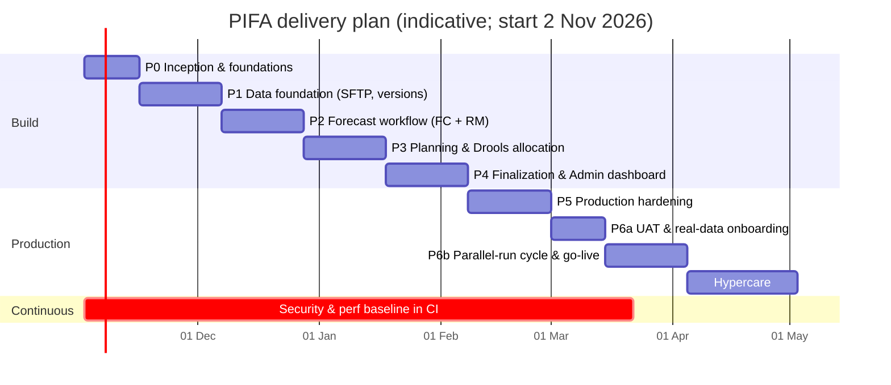

# Phase Plan — Building PIFA to Production Grade

| | |
|---|---|
| **Document** | Phased delivery plan |
| **Version** | 1.0 (draft for review) |
| **Date** | 21 Oct 2026 |
| **Related docs** | `PRD.md` (requirements: FR-/BR- IDs used below), `architecture.md` (design) |

---

## 1. Approach

- **Thin vertical slices, one stage of the workflow per phase.** Each phase ends with a working demo on the `dev`/`qa` environment using **synthetic data delivered through SFTP**, so the business sees real progress every 2–3 weeks.
- **Production concerns from day one.** CI/CD, security scanning, infrastructure as code and Keycloak realm-as-code start in Phase 0, not at the end. Phase 5 *hardens* these; it does not introduce them.
- **Synthetic first, real data last.** The synthetic generator uses the real Excel templates and the real SFTP path, so the switch to real data in Phase 6 is mainly an onboarding task, not a rebuild.
- **Rules are code.** Every Drools rule ships with tests. The PRD worked example (100 units → 25/25/25/25 → move 5 from East to North → 30/20/25/25) is an automated acceptance test from Phase 3 onward.

### 1.1 Assumed team

| Role | FTE |
|---|---|
| Tech lead / architect | 1 |
| Backend engineers (Java, Spring, Drools) | 2 |
| Frontend engineers (React, TypeScript) | 1.5 |
| QA automation engineer | 1 |
| DevOps / SRE | 0.5 (1.0 in Phase 5) |
| Product owner / business analyst | 0.5 |
| Business SMEs (Forecaster, Planner, 4 RMs, Admin) | Reviews, demos, UAT |

Durations below assume this team. A smaller team stretches the timeline roughly in proportion; a larger one can run Phases 3 and 4 partly in parallel.

---

## 2. Timeline (indicative)

| Phase | Duration | Cumulative | Milestone |
|---|---|---|---|
| P0 Inception & foundations | 2 wks | wk 2 | Log in to every role's empty dashboard; data contract signed |
| P1 Data foundation | 3 wks | wk 5 | SFTP file → versioned data on dashboard; download/delete work |
| P2 Forecast workflow | 3 wks | wk 8 | Forecast published and revised by all four regions |
| P3 Planning & allocation | 3 wks | wk 11 | Drools allocation approved by Planner |
| P4 Finalization & Admin | 3 wks | wk 14 | **Feature-complete**: full cycle end to end |
| P5 Production hardening | 3 wks | wk 17 | Pentest passed, NFRs met, DR drill done |
| P6 UAT, cutover, go-live | 5 wks | wk 22 | **Go-live** after one successful parallel cycle |
| Hypercare | 4 wks | wk 26 | Handover to BAU support |
| P7 Roadmap | ongoing | — | Integrations and enhancements |

---

## 3. Phases

### Phase 0 — Inception & foundations (2 weeks)

**Goal:** settle decisions and build the delivery pipeline and skeleton everything else plugs into.

**Scope**
- [ ] Resolve PRD open questions **Q1–Q10** (especially Q1 `Product_name` vs `Product_code`, Q2 cap-at-demand, Q3 transfer approver, Q6 SFTP hosting, Q10 hosting target).
- [ ] Pin versions (Java 21, Spring Boot 3.x, Drools 10.x, Keycloak, PostgreSQL 16) and write ADRs 001–008 (`architecture.md` §17).
- [ ] Create the monorepo (`architecture.md` §15), branch strategy, PR template and CODEOWNERS.
- [ ] Set up the CI pipeline: build, unit tests, SAST, dependency and image scanning, SBOM, Docker image publishing.
- [ ] Create a local `docker compose` stack: PostgreSQL, Keycloak, MinIO, SFTP (`atmoz/sftp`), ClamAV, Mailpit.
- [ ] **Keycloak realm as code**: realm `pifa-dev`, clients `pifa-web`/`pifa-api`/`pifa-automation`, four realm roles, `regions` user-profile attribute and mapper, audience mapper, test users per role and region.
- [ ] Spring Boot skeleton: JWT resource server, role and `RegionScope` conversion, `GET /me`, Actuator, Flyway, OpenAPI.
- [ ] React shell: OIDC login (PKCE), role-based landing, routes for the four dashboards, layout and design tokens.
- [ ] Terraform + Helm baseline for the `dev` environment.
- [ ] **Data contract sign-off**: `Forecast_Template.xlsx` and `Inventory_Template.xlsx` (`PRD.md` §8.3), SFTP folder contract (§8.2) and validation codes (§8.4).
- [ ] UX wireframes for the four dashboards, reviewed with SMEs.
- [ ] Drools spike: a KJAR with one rule, built with the executable model and run from Spring in a stateless session.

**Exit criteria**
- A test user of each role signs in through Keycloak on `dev` and lands on the correct (empty) dashboard. An RM token carries the `regions` claim.
- The CI pipeline is green, including scans. Merging to main deploys to `dev` automatically.
- Templates, SFTP contract, wireframes and open-question answers are signed off by the product owner.

---

### Phase 1 — Data foundation: synthetic data, SFTP ingestion, versioning, download & delete (3 weeks)

**Goal:** files dropped on SFTP become versioned, validated data visible on the right dashboard, with download and delete working safely.

**Scope**
- [ ] Flyway schema: `region`, `product`, `product_alias`, `planning_cycle`, `dataset_version`, `forecast_line`, `inventory_line`, `ingestion_job`, `ingestion_error`, `sales_history`, `audit_log`, `shedlock`, metadata store.
- [ ] Product and region master with `Product_name` normalization and alias lookup.
- [ ] **Synthetic data generator** (`PRD.md` §12): seeded products, 24-month sales history, forecast and inventory Excel files in the templates, negative test pack; drops files on SFTP; `source = SYNTHETIC`; disabled in the prod profile.
- [ ] **Worker ingestion pipeline** (`architecture.md` §5): SFTP poller with ShedLock, accept-once filter, size-stable check, staging to S3 with SHA-256, ClamAV, file-safety checks, POI streaming parse, structural validation.
- [ ] First Drools package `pifa.rules.ingestion` (unknown/duplicate product, quantity rules, month/date rules, spike warning) with rule tests.
- [ ] Error report (xlsx in S3 + CSV to SFTP `/outbound/errors/`) and notification to the uploader/Admin.
- [ ] **Versioning**: per-cycle numbering, statuses, single-active constraint, auto-activate policy, compare API.
- [ ] **Download**: original bytes (presigned URL), normalized xlsx/csv export with formula-injection guard and metadata sheet, blank templates, error reports.
- [ ] **Delete**: soft delete with reason and safeguards (not active, not referenced), undelete, Admin purge with tombstone.
- [ ] UI upload channel through the same pipeline (sync below 2 MB, async above).
- [ ] Frontend: shared **VersionHistoryPanel** (list, download, compare, activate, delete) and **Ingestion panel**, placed on the Forecaster and Planner dashboards; basic Admin data-management list.
- [ ] Audit log foundation (hash-chained), written for upload, activate, download of originals, delete, undelete and purge.

**PRD coverage:** §8, §9.2, §12, FR-FC-01..03, FR-PL-01, FR-AD-03, FR-AD-04 (basic), FR-AD-10, FR-COM-08.

**Exit criteria**
- A generator drop of forecast + inventory on SFTP appears as **v1** on the Forecaster and Planner dashboards within **5 minutes**. A second file becomes **v2** and the compare view shows the differences.
- Re-dropping the same content is rejected as `DUPLICATE_FILE`. **Every file in the negative pack is rejected with the expected code**, and its error report is downloadable and present in `/outbound/errors/`.
- Downloading the original returns a file whose SHA-256 equals the ingested hash. An exported xlsx re-uploads cleanly.
- Deleting the active or a referenced version is blocked. Soft delete, undelete and purge each create an audit entry.
- Killing the worker mid-ingestion leaves no partial version, and the file is picked up again.

---

### Phase 2 — Forecast workflow: Forecaster and Regional Manager dashboards (3 weeks)

**Goal:** the forecast moves from upload to a published forecast to four submitted regional revisions, under full edit control.

**Scope**
- [ ] Cycle state machine (`architecture.md` §9): `FORECAST_DRAFT`, `REGIONAL_REVIEW`, entry to `PLANNING`; per-region review sub-state; optimistic locking; `workflow_event`.
- [ ] Working copy (`plan_line`) and `change_log`; `FORECAST_WORKING_SNAPSHOT` when a new upload replaces edits.
- [ ] **EditPolicy** implementing the `PRD.md` §9.1 matrix, plus `GET /cycles/{id}/permissions`; tests for every matrix cell.
- [ ] **Forecaster dashboard**: editable forecast grid (product × regions + totals, difference from upload), validation panel, **Approve & publish** with Drools guard `BR-WF-01`, `FORECAST_PUBLISHED` snapshot, recall, regional tracker, review deadline.
- [ ] **Regional Manager dashboard**: My tasks, forecast review grid (all regions read-only, own region editable), **sales analysis** (3/6/12/24 months, sparkline, same month last year, drill-down chart), change % and reason, bulk edit, **submit**, `FORECAST_REVISED` snapshots.
- [ ] Drools package `pifa.rules.forecast` (`BR-VA-05`, `BR-VA-06`).
- [ ] Planner **return regions** action (minimal Planner screen).
- [ ] Notifications: transactional outbox, in-app list, email templates (publish, submit, return).
- [ ] Common grid features (`FR-COM-03..05, 07, 09`).

**PRD coverage:** FR-COM-01..09, FR-FC-04..09, FR-RM-01..05, FR-PL-06, BR-VA-05/06, BR-WF-01.

**Exit criteria**
- A synthetic cycle goes from SFTP upload → publish → all four regions submitted → `PLANNING`, entirely in the UI.
- An RM write to another region returns **403** in an API test, and the UI shows the cell as read-only. A change above the threshold without a reason is rejected.
- Every cell change is in `change_log` with old value, new value, user and reason. The correct snapshots exist with version numbers.
- Two users editing the same row produce a handled 409 conflict without silent overwrite.

---

### Phase 3 — Planning & Drools allocation: Planner dashboard (3 weeks)

**Goal:** the Planner sees revised demand against inventory, gets a rule-based proposal, adjusts it and approves it.

**Scope**
- [ ] Apply the active inventory version to the cycle (`plan_product_stock`); reserve edits with reason; allocatable and classification.
- [ ] **Demand vs stock grid** (`FR-PL-02`) with Constrained/Sufficient status and coverage %.
- [ ] Drools packages `pifa.rules.allocation.strategy` and `pifa.rules.allocation.validation` (`BR-AL-01..07`, `BR-VA-01..04`).
- [ ] `AllocationCalculator` (weighted baseline 25% default, remainder by unmet demand, full demand, optional cap-at-demand) with **property-based tests**; per-product explanation text.
- [ ] `rule_parameter` table and **Admin rule-parameters screen** (split weights total 100%, thresholds, floor, rounding, cap-at-demand), versioned with effective date; ruleset and parameter version stamped on every proposal and snapshot.
- [ ] Planner allocation grid: edit approved allocation, live totals, violations panel, **Approve** (`BR-WF-02`) → `ALLOCATION_APPROVED`, transition to `REGIONAL_FINALIZATION`.
- [ ] **Proceed after deadline** (`FR-PL-07`).
- [ ] New inventory version during `PLANNING` → re-run prompt with a diff (`FR-PL-09`).
- [ ] Allocation exports, all regions and one file per region (`FR-PL-10`).

**PRD coverage:** FR-PL-02..07, FR-PL-09..10, FR-AD-06, BR-AL-01..07, BR-VA-01..04, BR-WF-02.

**Exit criteria**
- **The PRD worked example is reproduced by an automated test**: Model A, 100 allocatable units, constrained → 25/25/25/25. A rounding test (102 units) assigns the remainder by unmet demand.
- An allocation with Σ > allocatable cannot be approved through the UI or the API.
- A proposal for **10,000 products** completes in **< 10 s** in the `qa` environment.
- Changing a rule parameter (for example weights 30/30/20/20) changes the next proposal without a deployment and creates an audit entry. Past snapshots keep the parameters they used.

---

### Phase 4 — Regional finalization & Admin dashboard (3 weeks)

**Goal:** RMs rebalance and finalize; Admin can analyse and trace everything. **The product is feature-complete.**

**Scope**
- [ ] RM allocation view: all regions' approved allocation, own demand, fill rate, shortfall (`FR-RM-06`).
- [ ] **Transfers**: create, accept, reject, cancel; Drools `pifa.rules.transfer` (`BR-TR-01..04`); transactional apply with ordered row locks; Planner escalation (`FR-RM-07`, `FR-PL-08`).
- [ ] Multi-region RM direct rebalance (`FR-RM-10`).
- [ ] Finalize and un-finalize per region; automatic `FINAL` with `ALLOCATION_FINAL` snapshot (`BR-WF-03`); Planner reopen; Admin reopen of `FINAL` with reason.
- [ ] **Admin dashboard**: overview (`FR-AD-01`); analytics (`FR-AD-02`: published vs revised vs approved vs final, fill rate, constrained share, transfer-flow Sankey, cycle time per stage, accuracy against synthetic actuals); full data management (`FR-AD-03`); ingestion monitor (`FR-AD-04`); master data UI with alias management and bulk import (`FR-AD-05`); audit search and export (`FR-AD-07`); cycle management (`FR-AD-08`); Keycloak users view (`FR-AD-09`).
- [ ] Live refresh through SSE (transfer requests and status changes appear without reload).
- [ ] Nightly audit hash-chain verification job with alert.
- [ ] Playwright E2E suite for a full monthly cycle with all four roles.

**PRD coverage:** FR-RM-06..10, FR-PL-08, FR-AD-01..10, BR-TR-01..04, BR-WF-03.

**Exit criteria**
- **E2E: the full cycle passes in CI** (upload → publish → revise ×4 → allocate → approve → transfer → finalize ×4 → `FINAL`).
- Worked example: transfer of 5 units of Model A from East to North gives **30/20/25/25, total 100**. A transfer from a finalized region is rejected.
- From the Admin dashboard, any final quantity can be traced to its source file version, Drools proposal, Planner edits and transfers, each with user, time and reason.
- All **Must** requirements in `PRD.md` §10 are demonstrated to the product owner.

---

### Phase 5 — Production hardening (3 weeks)

**Goal:** prove the platform is secure, fast, observable and recoverable before real data arrives.

**Scope**

*Security*
- [ ] OWASP ASVS L2 self-assessment and fixes; **external penetration test** and remediation.
- [ ] Keycloak production settings: MFA for Admin and Planner, brute-force protection, password policy, admin console network restriction, event forwarding; **corporate IdP federation** if confirmed (Q9).
- [ ] Secrets in the secret manager through External Secrets; key rotation runbook (DB, SFTP keys, Keycloak client secrets).
- [ ] WAF rules, ingress rate limiting, CSP/HSTS verified; DAST (ZAP) in the pipeline.

*Performance & reliability*
- [ ] k6 load test: 50 concurrent users across the four dashboards, 10k-product cycle, 50k-row file ingestion; DB index and query tuning; partitioning of `audit_log` and `change_log`.
- [ ] High availability: API ×2+ with HPA, worker ×2 with ShedLock failover test, Keycloak ×2 clustered, PostgreSQL HA (Multi-AZ / Patroni).
- [ ] Resilience tests: kill the worker during ingestion, SFTP unavailable, S3 unavailable, Keycloak restart; verify recovery and alerts.

*Operations*
- [ ] Observability: Grafana dashboards (API, ingestion, rules, DB, Keycloak, business progress); alert rules (`architecture.md` §14) routed to on-call; alert fire-drills.
- [ ] Backup and DR: PITR, cross-region copies, S3 versioning and replication; **restore drill** meeting RPO 15 min and RTO 4 h.
- [ ] `uat` and `prod` environments provisioned by Terraform; realm config applied by CI; blue/green or rolling deploy with automated smoke tests through the `pifa-automation` service account.
- [ ] Data retention jobs: purge of soft-deleted versions after 90 days, retention of files (3 years) and audit (7 years), S3 lifecycle rules.
- [ ] Accessibility audit (WCAG 2.1 AA) and fixes.
- [ ] Runbooks: rejected file, SFTP outage, reprocess file, restore version, reopen cycle, Keycloak outage, DB restore, key rotation.

**Exit criteria**
- Pentest: **no open critical or high findings**; medium findings have an agreed plan.
- Load-test report meets the `PRD.md` §13 performance targets at 2× the expected volume.
- DR drill completed within RTO/RPO and documented. Every alert has been triggered once and reached on-call.
- Runbooks reviewed by the support team. `prod` is deployable from Git alone.

---

### Phase 6 — UAT, real-data cutover and go-live (5 weeks)

**Goal:** business acceptance, a move from synthetic to real data with no surprises, and a controlled go-live.

**6a. UAT and real-data onboarding (2 weeks)**
- [ ] Scripted UAT on synthetic scenarios with the Forecaster, Planner, four RMs and Admin, covering every editability-matrix cell and every upload, download and delete action. Defects triaged and fixed.
- [ ] **Product master from the real catalogue**; alias mapping for `Product_name` variants; matching report (real file names against master) until there are zero unknowns.
- [ ] **Upstream onboarding to SFTP**: create `sftp-forecast` and `sftp-inventory` accounts, exchange keys, IP allowlist, `.part` → rename convention, test drops in UAT; agree drop schedule and an owner for rejected-file follow-up.
- [ ] One-off import of **real sales history** (24 months) for the RM analysis.
- [ ] Training: role-based quick guides and short videos; Admin and support training.
- [ ] UAT sign-off.

**6b. Parallel-run cycle and go-live (3 weeks)**
- [ ] Production readiness: **purge all synthetic data**, verify the generator is disabled and blocked in `prod`, real users and regions configured in Keycloak.
- [ ] **Parallel run**: one full monthly cycle in PIFA alongside the current spreadsheet process; reconcile final allocations; explain or fix every difference.
- [ ] Go/no-go meeting using the checklist in §5.
- [ ] Go-live, then **hypercare for 4 weeks** (daily check-ins, priority defect fixing, monitoring of ingestion and stage deadlines).

**Exit criteria**
- UAT signed off by the business owner.
- The parallel cycle reconciles (every difference explained).
- Go/no-go checklist complete; go-live approved.

---

### Phase 7 — Post-go-live roadmap (continuous)

Candidates, to be prioritized after hypercare:

| Item | Value |
|---|---|
| `Product_code` as the primary key in both files (Q1) | Removes name-matching risk |
| **SFTP sales/actuals feed** (same pipeline, `/inbound/sales/`) | Real forecast-accuracy analytics; live sales analysis for RMs |
| ERP/WMS **API integration** or S3-event-driven ingestion | Faster, push-based inventory updates |
| Weighted constrained split from historical sales share (rule parameter set) | Fairer baseline than equal 25% |
| Turn on **cap-at-demand** (Q2) after pilot data review | Avoid over-allocating low-demand regions |
| Branch/sub-region allocation level | Finer distribution |
| Forecast-assist (suggested revisions from sales trends) | Faster, better RM revisions |
| Mobile-friendly approval and finalize actions | Faster sign-offs |
| SLA and stage-deadline reporting, automated reminders | Shorter cycle time (goal G5) |

---

## 4. Cross-cutting quality gates

Every phase must meet these before its demo:

| Gate | Standard |
|---|---|
| **Definition of Done (story)** | Code reviewed; unit tests (≥ 80% line coverage on domain and rules modules); API documented in OpenAPI; authorization tests for new endpoints; audit events for new state changes; no new critical/high scan findings; feature demoed on `dev` |
| **Rules** | Every DRL rule has positive and negative tests; ruleset version bumped on change; change log in the rules module |
| **Data** | Flyway migrations are forward-only and tested against a copy of the previous schema; no destructive migration without a backup step |
| **Security** | SAST, dependency and image scan green; secrets never in Git; Keycloak changes only through realm-as-code |
| **Environments** | `dev` auto-deploys from main; `qa` from release candidates; `uat` and `prod` by approved promotion of the same image digest |
| **Demo** | End-of-phase demo to SMEs on synthetic data; feedback logged in the backlog before the next phase starts |

---

## 5. Go-live checklist

| # | Item | Owner |
|---|---|---|
| 1 | All **Must** requirements accepted in UAT | Product owner |
| 2 | Pentest: no open critical/high; ASVS L2 checklist complete | Security |
| 3 | Load test at 2× volume meets performance targets | QA / SRE |
| 4 | DR restore drill passed (RPO 15 min, RTO 4 h) | SRE |
| 5 | Alerts routed to on-call and tested; runbooks published | SRE / support |
| 6 | Keycloak prod realm: real users, roles, regions, MFA enforced, federation tested | IAM admin |
| 7 | SFTP: upstream accounts and keys live, test drop in prod passed, error-report path confirmed with upstream owners | Integration |
| 8 | Product master and aliases loaded; real-file matching report shows zero unknown products | Admin / business |
| 9 | Synthetic data purged; generator disabled and blocked in prod | Tech lead |
| 10 | Rule parameters reviewed and signed off (split weights, threshold, floor, cap-at-demand) | Planner / business owner |
| 11 | Parallel-run cycle reconciled | Business owner |
| 12 | Users trained; support model and escalation contacts published | Product owner |
| 13 | Backup jobs green for 7 consecutive days in prod | SRE |
| 14 | Rollback plan rehearsed (previous image + DB restore point) | Tech lead / SRE |

---

## 6. Risks and mitigations

| Risk | Impact | Likelihood | Mitigation | Phase |
|---|---|---|---|---|
| `Product_name` differs between forecast, inventory and master (spelling, spacing) | Files rejected; mismatched joins | High | Normalization + alias table; matching report during onboarding; recommend `Product_code` (Q1) | P1, P6a |
| Upstream systems cannot follow the `.part` → rename convention | Partial files read | Medium | Size-stable check across polls; optional `.done` marker mode | P1 |
| Disagreement on allocation policy (25% baseline, cap-at-demand, transfer approver) | Rework of rules | Medium | Decide Q2/Q3 in P0; policy held as parameters; rule tests document the behaviour | P0, P3 |
| Drools learning curve | Slower P1/P3 | Medium | P0 spike; keep arithmetic in Java; rule test harness and code review by the tech lead | P0–P3 |
| Keycloak operational complexity (HA, upgrades) | Login outages | Medium | Keycloak Operator or managed hosting; realm-as-code; HA and restore tested in P5; upgrade runbook | P0, P5 |
| Real data volumes exceed assumptions | Slow dashboards and ingestion | Low–Med | Design for 10k products; load-test at 2×; partitioning and indexes | P5 |
| Low adoption; users keep using spreadsheets | Goals G1/G5 missed | Medium | SME demos every phase; Excel round-trip (export/import) supported; training; parallel run | All |
| Scope creep into building a forecasting model | Delay | Medium | Explicit non-goal in `PRD.md` §3.2; roadmap item only | All |
| Synthetic data left in production | Wrong decisions | Low | `SYNTHETIC` tagging and banner; prod guard; purge on go-live checklist | P1, P6b |
