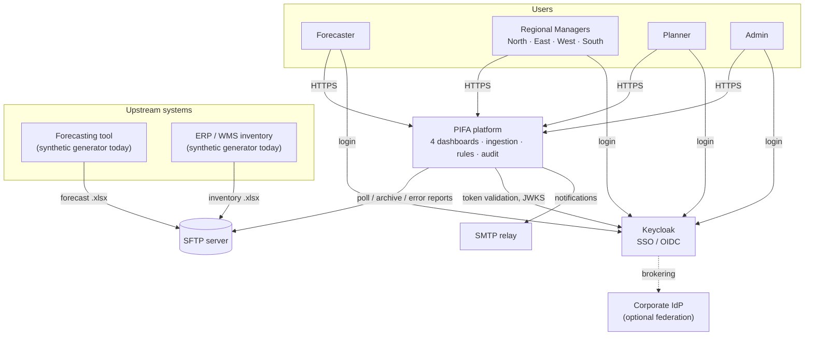
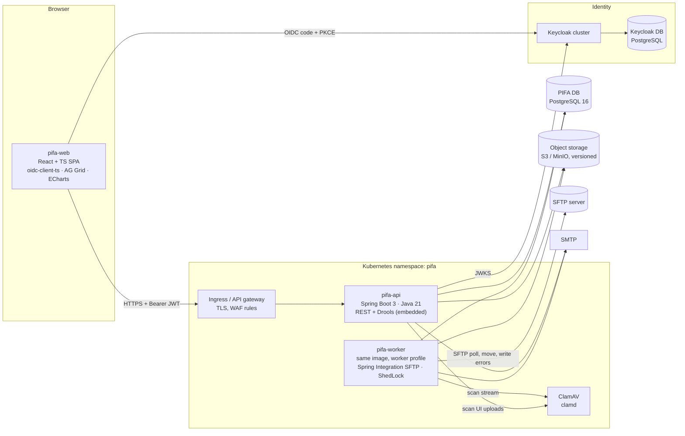
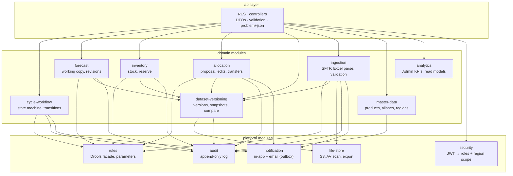
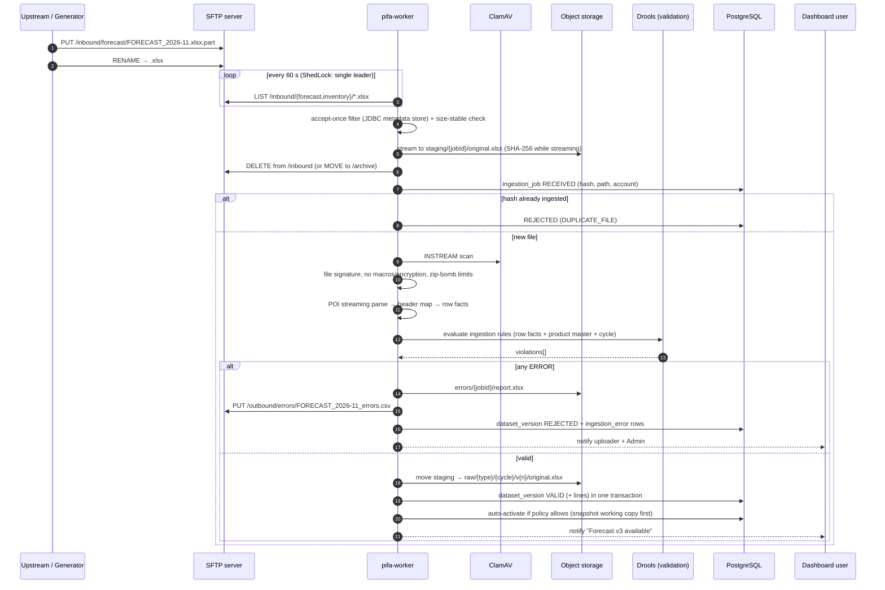
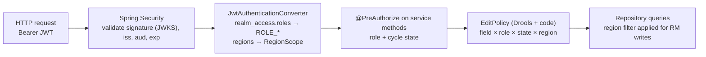
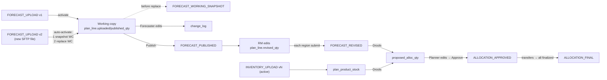
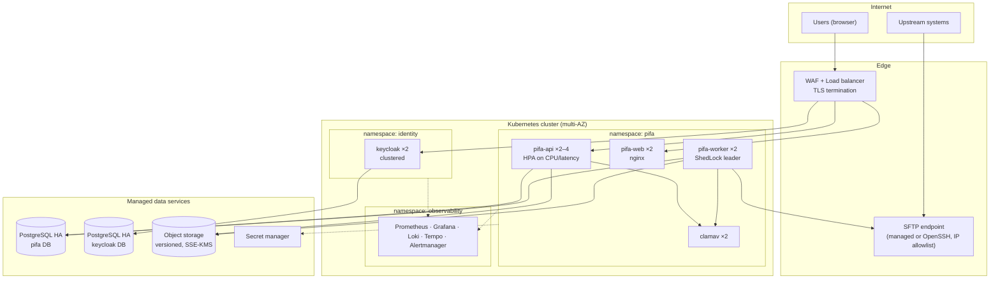

# Architecture — Printer Inventory Forecasting & Regional Allocation (PIFA)

| | |
|---|---|
| **Document** | Solution architecture |
| **Version** | 1.0 (draft for review) |
| **Date** | 21 Oct 2026 |
| **Related docs** | `PRD.md` (what and why), `Phase.md` (delivery plan) |

---

## 1. Architecture at a glance

PIFA is a **modular monolith** built with **Spring Boot (Java 21)** and a **React + TypeScript** web app. It is deployed as two runtime roles from one codebase:

- **`pifa-api`** serves the four dashboards through a REST API.
- **`pifa-worker`** polls SFTP, ingests Excel files, and runs scheduled jobs.

Platform services:

| Concern | Choice |
|---|---|
| Identity, SSO, roles, region scoping | **Keycloak** (OIDC) |
| Business rules (validation, allocation, transfer and workflow guards) | **Drools** (embedded, rules packaged as a versioned KJAR) |
| File intake | **SFTP** server + Spring Integration SFTP poller |
| Business data, versions, audit | **PostgreSQL** |
| Raw files, exports, error reports | **S3-compatible object storage** (S3 / MinIO) with bucket versioning |
| File malware scanning | **ClamAV** |
| Email notifications | SMTP relay |

### 1.1 Design principles

1. **One source of truth.** Every dashboard reads the same PostgreSQL data. A change in one dashboard is visible in the next straight away.
2. **Immutable versions, mutable working copies.** Files and sign-offs create immutable versions. Editing happens on a working copy, and every cell change is logged.
3. **Rules outside code paths.** Allocation and validation policy lives in Drools rules. Numeric parameters are Admin-editable data. Neither needs a UI change.
4. **Server-side enforcement.** Role, region, state and editability checks run in the API and in Drools. The UI only reflects them.
5. **Same pipeline for synthetic and real data.** The synthetic generator writes real Excel files to SFTP, so going live changes who supplies the file, not the code.
6. **Start as a monolith, keep clear boundaries.** Modules talk through interfaces and domain events, so any module (for example ingestion) can be split into its own service later if scale requires it.

---

## 2. System context



---

## 3. Containers and technology



### 3.1 Technology stack

| Layer | Technology | Why |
|---|---|---|
| Frontend | React 18, TypeScript, Vite, React Router, TanStack Query | Mainstream SPA stack, strong typing, server-state caching |
| Grids | AG Grid (Community; Enterprise optional for Excel-like range editing) | Cell-level editability by role, 10k-row virtual scrolling, pinned columns |
| Charts | Apache ECharts | Sales history, analytics, Sankey for transfer flows |
| Auth (browser) | `oidc-client-ts` / `react-oidc-context` | Standards-based OIDC with PKCE, silent token renew |
| Backend | Java 21, Spring Boot 3.x, Spring Security (OAuth2 Resource Server), Spring Data JPA, Spring Integration SFTP | Mature ecosystem with first-class Keycloak (JWT) and Drools support |
| Rules | **Drools** (Apache KIE, 10.x line), executable model, stateless sessions | Business rules separate from code, testable, versioned as an artifact |
| Excel | Apache POI (streaming SAX reader for import, SXSSF for export) | Handles large files with low memory |
| Database | PostgreSQL 16, Flyway migrations | Relational integrity, JSONB for rule payloads, mature HA options |
| Object storage | S3 API (AWS S3 / MinIO), bucket versioning, optional object lock | Cheap, durable raw-file archive; versioned |
| Identity | **Keycloak** (current supported release), PostgreSQL backend | Open-source SSO, RBAC, MFA, IdP brokering, admin console |
| Scheduling | Spring Integration pollers, Spring `@Scheduled` + **ShedLock** (JDBC) | Exactly-one-runner across replicas without extra infrastructure |
| API docs | springdoc-openapi (OpenAPI 3.1) | Contract for frontend and future integrations |
| Packaging | Docker (distroless/Temurin JRE base), Helm charts | Repeatable deploys |
| IaC | Terraform (cloud resources, Keycloak realm through the Keycloak provider) | Environments and realm config as code |
| CI/CD | GitHub Actions or GitLab CI; Trivy, OWASP Dependency-Check, Semgrep/SonarQube | Build, test, scan, deploy |
| Observability | Micrometer → Prometheus, OpenTelemetry → Tempo/Jaeger, JSON logs → Loki/ELK, Grafana | Metrics, traces and logs with correlation |

> Exact versions (Spring Boot, Drools, Keycloak, PostgreSQL) are pinned to the latest stable releases in **Phase 0** and kept current through Renovate/Dependabot.

---

## 4. Backend module structure

One Spring Boot application, organized as Gradle (or Maven) modules with enforced dependencies (ArchUnit tests).



| Module | Responsibility |
|---|---|
| `cycle-workflow` | Cycle states and per-region sub-states (`PRD.md` §7). Transitions run Drools guard rules, create snapshots and publish domain events (`CyclePublished`, `RegionSubmitted`, `AllocationApproved`, `RegionFinalized`, `CycleFinalized`). |
| `forecast` | Forecast working copy (`plan_line` forecast columns), Forecaster and RM edits, change log, sales-history queries |
| `inventory` | Applies the active inventory version to the cycle (`plan_product_stock`), reserve edits |
| `allocation` | Calls Drools for the proposal, Planner edits, transfers, finalization |
| `dataset-versioning` | Version registry, activation, soft delete / undelete / purge, compare, restore, snapshot creation |
| `ingestion` | SFTP polling, staging, AV scan, POI parsing, structural plus Drools validation, error reports, version creation |
| `master-data` | Products, aliases (`Product_name` normalization), regions |
| `analytics` | Read-optimized queries and materialized views for the Admin dashboard |
| `rules` | Loads the KJAR, exposes typed `evaluate*()` methods, reads rule parameters |
| `security` | JWT → authorities, `RegionScope` resolver, method-level security |
| `audit` | Append-only, hash-chained audit records |
| `file-store` | S3 put/get/delete, presigned download URLs, ClamAV client, Excel export with formula-injection guard |
| `notification` | Transactional outbox → email and in-app notifications |

Domain events are delivered in-process with `@TransactionalEventListener`. Anything external (email) goes through a **transactional outbox** table, so a notification is never sent for a change that was rolled back.

---

## 5. SFTP ingestion pipeline

### 5.1 Flow



### 5.2 Key design points

| Topic | Design |
|---|---|
| **Routing to dashboard** | The folder sets the dataset type: `/inbound/forecast` → `FORECAST_UPLOAD` (Forecaster dashboard), `/inbound/inventory` → `INVENTORY_UPLOAD` (Planner dashboard). Each SFTP account is chrooted to its own folder, so one source cannot drop the other's type. |
| **Partial uploads** | Producers upload `*.part` and rename. The poller filters on `*.xlsx` and requires the same size and mtime across two polls. |
| **Exactly once** | `SftpPersistentAcceptOnceFileListFilter` backed by a `JdbcMetadataStore` (path + mtime), **plus** a SHA-256 content-hash unique constraint on `dataset_version`. The same content under a new name is rejected as `DUPLICATE_FILE`. |
| **Single runner** | Pollers and scheduled jobs are guarded by ShedLock, so with N worker replicas only one polls at a time. |
| **Atomicity** | Parsing and validation happen before any business write. Version, lines and audit are written in **one DB transaction**. The S3 object is moved from `staging/` to `raw/` only after commit. An hourly sweeper removes orphaned staging objects. |
| **All-or-nothing** | Any ERROR rejects the file. There are no partial loads (`PRD.md` §8.4). |
| **Large files** | POI SAX streaming (`XSSFReader`) with batched JDBC inserts. 50k rows parse in seconds with bounded memory. |
| **Formulas** | Cached values are read. A formula cell with no cached value gets `QTY_INVALID`. External links are rejected. |
| **Error feedback** | Error report in S3 (downloadable in the dashboard), CSV in SFTP `/outbound/errors/`, and in-app plus email notification |
| **UI uploads** | `POST /api/v1/datasets/{type}/uploads` streams to the same staging area and invokes the same `IngestionService` (synchronously for files under 2 MB, otherwise asynchronously with a job id the UI polls) |
| **SFTP server options** | (a) Managed: AWS Transfer Family (S3-backed) or Azure Blob SFTP. (b) Self-hosted OpenSSH (`internal-sftp`, chroot, key-only) on a VM or Kubernetes with a persistent volume. The worker uses plain SFTP, so either works. With S3-backed managed SFTP, an S3 event can replace polling later. |
| **SFTP auth** | Key-only (ed25519) per-system accounts, IP allowlist, no shell. The worker's own private key and the server host key fingerprint (strict host key checking) are stored in the secret store. |

### 5.3 Excel to domain mapping

| Excel | Domain |
|---|---|
| Forecast row (`Product_name`, `Forecast_Month`, `North`…`South`) | Four `forecast_line` rows (product × region × qty) under the version |
| Inventory row (`Product_name`, `Available_Qty`, `As_Of_Date`, `Planning_Month?`) | One `inventory_line` row under the version |
| `Product_name` | Normalized (`trim`, collapse whitespace, Unicode NFKC, case-fold), then looked up in `product.normalized_name`, then in `product_alias.normalized_alias` |

---

## 6. Identity and access — Keycloak

### 6.1 Realm design

| Item | Configuration |
|---|---|
| **Realm** | `pifa` (one per environment: `pifa-dev`, `pifa-qa`, `pifa-uat`, `pifa` in prod, or separate Keycloak per environment) |
| **Clients** | `pifa-web`: public, standard flow, **PKCE S256**, exact redirect URIs, web origins limited to the app domain<br/>`pifa-api`: bearer-only/resource audience; an audience mapper adds `pifa-api` to `aud` of tokens issued to `pifa-web`<br/>`pifa-automation`: confidential, **service account** (client credentials) for CI smoke tests and future system integrations |
| **Realm roles** | `forecaster`, `regional_manager`, `planner`, `admin` (composite roles are not used, which keeps separation of duties explicit) |
| **Region scoping** | User Profile attribute `regions` (multi-valued, validator: `NORTH`, `EAST`, `WEST`, `SOUTH`), emitted by a **User Attribute mapper** as token claim `regions`. Groups `/regions/<name>` can be used for administration, with a group-attribute mapper. |
| **Token settings** | Access token 5 min; SSO session idle 30 min, max 10 h; refresh token rotation on; `offline_access` disabled for `pifa-web` |
| **MFA** | Conditional OTP / WebAuthn **required** for `admin` and `planner`, optional for others (authentication flow with a role condition) |
| **Protection** | Brute-force detection, password policy (length 12+, history, not username), email verification, admin console only on the internal network |
| **Federation** | Optional OIDC/SAML brokering to the corporate IdP (Entra ID / Google / Okta) or LDAP user federation, with role and region mapping from IdP groups |
| **Events** | Login and admin events on; forwarded to the log pipeline/SIEM |
| **Config as code** | Realm, clients, roles, mappers and flows managed by the Terraform Keycloak provider (or `keycloak-config-cli`) in the repo and applied by CI. No click-ops in UAT or prod. |

Example access token (trimmed):

```json
{
  "iss": "https://sso.example.com/realms/pifa",
  "aud": ["pifa-api"],
  "sub": "8c1e…",
  "preferred_username": "anita.north",
  "realm_access": { "roles": ["regional_manager"] },
  "regions": ["NORTH"],
  "acr": "1"
}
```

### 6.2 Enforcement in the API



- **Role check**: method security, for example `@PreAuthorize("hasRole('REGIONAL_MANAGER')")`.
- **Region check**: `RegionScope.assertCanEdit(region)`. An RM write to a region not in the `regions` claim returns **403** and creates a security audit event.
- **Editability**: a single `EditPolicy` component implements the `PRD.md` §9 matrix (field × role × cycle state × region sub-state). The UI calls `GET /cycles/{id}/permissions` to know which cells to enable, but the API re-checks on every write.
- **No trust in the client**: totals, constrained flags and the allocation itself are always recomputed on the server.

---

## 7. Rules engine — Drools

### 7.1 What Drools decides (and what it doesn't)

| In Drools (policy) | In Java (mechanics) |
|---|---|
| Ingestion business validation (unknown/duplicate product, quantity bounds, month mismatch, spikes) | File structure checks, parsing, hashing, AV |
| Classify each model as Constrained/Sufficient; choose strategy (equal/weighted baseline, demand, cap-at-demand) | Integer arithmetic of the split and remainder distribution (`AllocationCalculator`, property-tested) |
| Validate allocation (Σ ≤ allocatable, negatives, over-demand, zero-region warnings) | Persisting results |
| Forecast change control (reason above threshold) | Change-log writes |
| Transfer validation (floor, finalized region, donor quantity) | Applying the transfer atomically |
| Workflow guard rules (can publish, approve, finalize) | State machine transitions |

This split keeps arithmetic deterministic and unit-testable in Java. **Policy** (when to apply which strategy, what counts as a violation, its severity and message) stays in rules that can be read and changed without touching services.

### 7.2 Packaging and runtime

- Rules live in a separate module `pifa-rules` (a **KJAR**: `src/main/resources/rules/**/*.drl` + `kmodule.xml`), built with the **executable model** for fast startup. It has its own semantic version (for example `pifa-rules:1.4.0`) and its own unit-test suite.
- The API and worker embed the KJAR. A singleton `KieContainer` / `KieBase` is created at startup, and a **stateless** `KieSession` is created per evaluation (thread-safe, no shared state).
- Rule **parameters** (split weights, thresholds, floor, spike factor, rounding policy, cap-at-demand) are read from the `rule_parameter` table and inserted as an `AllocationConfig` / `ValidationConfig` fact. Admin edits them in the dashboard; changes are versioned with `effective_from` and audited.
- Every evaluation records the **ruleset version and parameter version** on the resulting snapshot or violation set, so any historical allocation can be explained and reproduced.
- Rule changes go through a PR with tests, CI and a normal release. Hot-reloading rules in production is deliberately **not** enabled.

KIE bases and packages:

| Package | Purpose | Used by |
|---|---|---|
| `pifa.rules.ingestion` | Row-level business validation | worker, UI upload |
| `pifa.rules.forecast` | Revision change control | forecast module |
| `pifa.rules.allocation.strategy` | Classify product, emit `AllocationDirective` | allocation module |
| `pifa.rules.allocation.validation` | Allocation violations | allocation module |
| `pifa.rules.transfer` | Transfer validation | allocation module |
| `pifa.rules.workflow` | Transition guards | cycle-workflow |

### 7.3 Example rules (illustrative DRL)

```drl
package pifa.rules.allocation.strategy;

import com.pifa.rules.model.*;

rule "Classify constrained product"
    salience 100
when
    $s : ProductStock( $pid : productId, $alloc : allocatableQty, classification == null )
    accumulate( RegionDemand( productId == $pid, $d : revisedQty );
                $total : sum( $d );
                $total > $alloc )
then
    modify( $s ) { setClassification( Classification.CONSTRAINED ) }
end

rule "Classify sufficient product"
    salience 90
when
    $s : ProductStock( classification == null )
then
    modify( $s ) { setClassification( Classification.SUFFICIENT ) }
end

rule "Constrained: weighted baseline split (default 25% each)"
when
    $s   : ProductStock( classification == Classification.CONSTRAINED, $pid : productId )
    $cfg : AllocationConfig( capAtDemand == false )
then
    insert( new AllocationDirective( $pid, Strategy.WEIGHTED_BASELINE, $cfg.getRegionWeights() ) );
end

rule "Constrained: baseline capped at demand"
when
    $s   : ProductStock( classification == Classification.CONSTRAINED, $pid : productId )
    $cfg : AllocationConfig( capAtDemand == true )
then
    insert( new AllocationDirective( $pid, Strategy.WEIGHTED_BASELINE_CAPPED, $cfg.getRegionWeights() ) );
end

rule "Sufficient: allocate full revised demand"
when
    $s : ProductStock( classification == Classification.SUFFICIENT, $pid : productId )
then
    insert( new AllocationDirective( $pid, Strategy.FULL_DEMAND, null ) );
end
```

```drl
package pifa.rules.allocation.validation;

import com.pifa.rules.model.*;

rule "BR-VA-01 Allocation must not exceed allocatable stock"
when
    $s : ProductStock( $pid : productId, $max : allocatableQty )
    accumulate( AllocationLine( productId == $pid, $q : qty );
                $total : sum( $q );
                $total > $max )
then
    insert( Violation.error( "BR-VA-01", $pid, null,
            "Allocated " + $total + " exceeds allocatable " + $max ) );
end

rule "BR-VA-03 Region allocation above revised demand"
when
    AllocationLine( $pid : productId, $r : region, $q : qty )
    RegionDemand( productId == $pid, region == $r, revisedQty < $q, $d : revisedQty )
then
    insert( Violation.warning( "BR-VA-03", $pid, $r,
            $r + " allocated " + $q + " vs demand " + $d ) );
end
```

### 7.4 Allocation calculation (Java, after Drools directives)

```
for each product with directive WEIGHTED_BASELINE:
    base[r]   = floor(allocatable × weight[r])          // 25% each by default
    remainder = allocatable − Σ base[r]
    order regions by (revisedDemand[r] − base[r]) desc, then display order N,E,W,S
    give +1 to regions in that order until remainder = 0
for FULL_DEMAND:
    alloc[r] = revisedDemand[r];  unallocated = allocatable − Σ alloc
for WEIGHTED_BASELINE_CAPPED:
    iterate: cap at demand, pool the excess, redistribute pro rata to unmet demand,
    then distribute any rounding remainder as above
→ AllocationLines → Drools validation package → violations + explanation text
```

Property-based tests (jqwik) assert three invariants for random inputs: Σ alloc ≤ allocatable, no alloc < 0, and the result is deterministic.

---

## 8. Data model

### 8.1 Entity-relationship diagram

```mermaid
erDiagram
    REGION ||--o{ PLAN_LINE : "per region"
    PRODUCT ||--o{ PRODUCT_ALIAS : has
    PRODUCT ||--o{ PLAN_LINE : "per product"
    PRODUCT ||--o{ PLAN_PRODUCT_STOCK : "per product"
    PRODUCT ||--o{ SALES_HISTORY : has
    PLANNING_CYCLE ||--o{ PLAN_LINE : contains
    PLANNING_CYCLE ||--o{ PLAN_PRODUCT_STOCK : contains
    PLANNING_CYCLE ||--o{ CYCLE_REGION_STATUS : tracks
    PLANNING_CYCLE ||--o{ DATASET_VERSION : versions
    PLANNING_CYCLE ||--o{ TRANSFER_REQUEST : has
    PLANNING_CYCLE ||--o{ WORKFLOW_EVENT : logs
    DATASET_VERSION ||--o{ FORECAST_LINE : "forecast types"
    DATASET_VERSION ||--o{ INVENTORY_LINE : "inventory type"
    DATASET_VERSION ||--o{ ALLOCATION_LINE : "allocation types"
    DATASET_VERSION ||--o| INGESTION_JOB : "created by"
    INGESTION_JOB ||--o{ INGESTION_ERROR : reports
    PLAN_LINE ||--o{ CHANGE_LOG : "cell edits"

    PLANNING_CYCLE {
        uuid id PK
        char7 month "YYYY-MM, unique"
        text state "FORECAST_DRAFT..FINAL"
        timestamptz review_deadline
        timestamptz finalize_deadline
        bigint row_version
    }
    PRODUCT {
        uuid id PK
        text product_name
        text normalized_name "unique"
        text product_code "nullable, future key"
        boolean active
    }
    PRODUCT_ALIAS {
        uuid id PK
        uuid product_id FK
        text normalized_alias "unique"
    }
    REGION {
        text code PK "NORTH, EAST, WEST, SOUTH"
        text name
        int display_order
        boolean active
    }
    DATASET_VERSION {
        uuid id PK
        uuid cycle_id FK
        text type "FORECAST_UPLOAD, INVENTORY_UPLOAD, FORECAST_WORKING_SNAPSHOT, FORECAST_PUBLISHED, FORECAST_REVISED, ALLOCATION_APPROVED, ALLOCATION_FINAL"
        int version_no "per cycle+type"
        text label "FC-2026-11-v3"
        text source "SFTP, UI, SYNTHETIC, SYSTEM"
        text status "RECEIVED..ACTIVE, SUPERSEDED, REJECTED, DELETED"
        boolean is_active
        text original_filename
        text object_key
        char64 sha256 "unique for uploads"
        int row_count
        text ruleset_version
        uuid parameter_version_id
        uuid parent_version_id
        text created_by
        timestamptz created_at
        text deleted_by
        timestamptz deleted_at
        text delete_reason
    }
    FORECAST_LINE {
        uuid version_id FK
        uuid product_id FK
        text region_code FK
        int qty
        text comment
    }
    INVENTORY_LINE {
        uuid version_id FK
        uuid product_id FK
        int available_qty
        date as_of_date
    }
    ALLOCATION_LINE {
        uuid version_id FK
        uuid product_id FK
        text region_code FK
        int qty
    }
    PLAN_LINE {
        uuid id PK
        uuid cycle_id FK
        uuid product_id FK
        text region_code FK
        int uploaded_qty
        int published_qty
        int revised_qty
        text revision_reason
        int proposed_alloc_qty
        int approved_alloc_qty
        int final_alloc_qty
        bigint row_version "optimistic lock"
    }
    PLAN_PRODUCT_STOCK {
        uuid cycle_id FK
        uuid product_id FK
        uuid inventory_version_id FK
        int available_qty
        int reserve_qty
        text reserve_reason
        int allocatable_qty "generated"
        text classification "CONSTRAINED, SUFFICIENT"
        text allocation_explanation
        bigint row_version
    }
    CYCLE_REGION_STATUS {
        uuid cycle_id FK
        text region_code FK
        text review_status "OPEN, SUBMITTED"
        text finalize_status "OPEN, FINALIZED"
        text actor
        timestamptz updated_at
    }
    TRANSFER_REQUEST {
        uuid id PK
        uuid cycle_id FK
        uuid product_id FK
        text from_region
        text to_region
        int qty
        text status "REQUESTED, ACCEPTED, REJECTED, CANCELLED"
        text reason
        text requested_by
        text decided_by
        timestamptz decided_at
    }
    CHANGE_LOG {
        bigint id PK
        uuid plan_line_id FK
        text field
        int old_value
        int new_value
        text reason
        text actor
        timestamptz at
    }
    INGESTION_JOB {
        uuid id PK
        text channel "SFTP, UI"
        text sftp_account
        text source_path
        char64 sha256
        text status
        int error_count
        text error_report_key
        timestamptz started_at
        timestamptz finished_at
    }
    INGESTION_ERROR {
        uuid job_id FK
        int row_no
        text column_name
        text code
        text severity
        text message
    }
    SALES_HISTORY {
        uuid product_id FK
        text region_code FK
        char7 month
        int qty
        text source "SYNTHETIC, FEED"
    }
    WORKFLOW_EVENT {
        bigint id PK
        uuid cycle_id FK
        text from_state
        text to_state
        text region_code
        text actor
        text comment
        timestamptz at
    }
```



Supporting tables (not drawn): `rule_parameter` (key, value JSONB, version, effective_from, changed_by), `audit_log` (append-only, hash chain), `notification`, `outbox_event`, `shedlock`, `int_metadata_store` (Spring Integration accept-once filter).

### 8.2 How versioning works



- **Working tables** (`plan_line`, `plan_product_stock`) hold one row per product × region per cycle, with a column for each stage. Dashboards therefore read the current state and the previous-stage comparison in one query.
- **Snapshots** copy those columns into `forecast_line` or `allocation_line` under a new `dataset_version` at each sign-off. They are immutable, and DB triggers block `UPDATE`/`DELETE` on lines of non-draft versions.
- **Uniqueness**: a partial unique index on `(cycle_id, type) WHERE is_active` enforces a single active version.
- **Soft delete** sets `status = DELETED`, `deleted_*`, and moves the raw object key to a `deleted/` prefix (S3 lifecycle). It is blocked by FK-style checks when the version is active or referenced by a published, approved or final snapshot (`parent_version_id` chain). **Purge** removes lines and the S3 object (all object versions) and keeps a tombstone row and audit entry.
- **Compare** is a set-difference SQL query over the lines of two versions (added, removed and changed products, and per-region deltas). It is exposed as an API and an Excel export.

### 8.3 Audit log

- Append-only table. The app DB role has `INSERT` and `SELECT` only. Each row stores `prev_hash` and `hash = sha256(prev_hash || row)` for tamper evidence. A nightly job verifies the chain and alerts on any break.
- It records: actor (Keycloak `sub` + username), roles, region claim, action, entity, field, old/new value, reason, cycle, request id, IP, user agent.
- It is partitioned by month and retained 7 years. Old partitions can be exported to object storage with object lock.

---

## 9. Workflow (cycle state machine)

Implemented as an explicit transition table in `cycle-workflow` (a small enum-based state machine; Spring Statemachine is not needed at this size). Each transition is:

1. Authorized by role (and region for RM actions).
2. Guarded by `pifa.rules.workflow` rules, for example BR-WF-01/02/03.
3. Executed in one transaction: state change, snapshot creation, `workflow_event` and audit rows, outbox notifications.
4. Protected by optimistic locking on `planning_cycle.row_version`, so two users acting at once cannot both succeed.

| Transition | Actor | Guard (Drools) | Side effects |
|---|---|---|---|
| `FORECAST_DRAFT → REGIONAL_REVIEW` (publish) | Forecaster | Active forecast exists, no ERROR violations | `FORECAST_PUBLISHED` snapshot; `published_qty` frozen; `revised_qty := published_qty`; notify RMs |
| `REGIONAL_REVIEW → FORECAST_DRAFT` (recall) | Forecaster, Admin | No region submitted (Admin: any, with reason) | Region statuses reset |
| Region `OPEN → SUBMITTED` | RM (own region) | BR-VA-05 passes for the region | Regional `FORECAST_REVISED` snapshot |
| `REGIONAL_REVIEW → PLANNING` | System (all submitted) or Planner (after deadline) | All submitted, or deadline passed | Consolidated `FORECAST_REVISED`; Drools proposal computed |
| `PLANNING → REGIONAL_REVIEW` (return) | Planner | Comment present | Selected regions back to `OPEN` |
| `PLANNING → REGIONAL_FINALIZATION` (approve) | Planner | BR-WF-02 | `ALLOCATION_APPROVED` snapshot; `final_alloc_qty := approved_alloc_qty` |
| `REGIONAL_FINALIZATION → PLANNING` (reopen) | Planner | Comment present | Pending transfers cancelled; regions `OPEN` |
| Region `OPEN ↔ FINALIZED` | RM (own region) | BR-WF-03 (no pending transfers for the region) | — |
| `REGIONAL_FINALIZATION → FINAL` | System | All regions FINALIZED, no pending transfers, BR-VA-01/02 | `ALLOCATION_FINAL` snapshot; cycle locked |
| `FINAL → REGIONAL_FINALIZATION` (reopen) | Admin | Reason present | Audit with high severity; notify all |

**Transfers** are applied in one transaction: lock both `plan_line` rows (`SELECT … FOR UPDATE` in a fixed region order to avoid deadlock), re-run `pifa.rules.transfer`, then move the quantity and write change log, audit and notification.

---

## 10. API design

REST, JSON, versioned under `/api/v1`, documented with OpenAPI. Errors use RFC 9457 `application/problem+json` with stable error codes. Writes accept the row `rowVersion` (ETag/If-Match on single resources) for optimistic locking.

| Area | Endpoint | Roles |
|---|---|---|
| Session | `GET /me` (roles, regions, landing dashboard) | all |
| Cycles | `GET /cycles`, `POST /cycles`, `GET /cycles/{id}` | read: all; create: Admin, Forecaster |
| Permissions | `GET /cycles/{id}/permissions` (editable fields for the caller) | all |
| Transitions | `POST /cycles/{id}/transitions` `{action: PUBLISH, RECALL, SUBMIT_REGION, PROCEED, RETURN_REGIONS, APPROVE_ALLOCATION, REOPEN_ALLOCATION, FINALIZE_REGION, UNFINALIZE_REGION, REOPEN_CYCLE, region?, comment}` | per §9 |
| Forecast | `GET /cycles/{id}/forecast?region=&q=&page=`; `PATCH /cycles/{id}/forecast/lines` (batch `{lineId, field, value, reason, rowVersion}`) | read: all; write: Forecaster / RM per matrix |
| Sales analysis | `GET /sales-history?productId=&region=&months=24` | Forecaster, RM, Planner, Admin |
| Inventory & stock | `GET /cycles/{id}/stock`; `PATCH /cycles/{id}/stock/{productId}` (reserve) | read: all; write: Planner |
| Allocation | `POST /cycles/{id}/allocation/proposal` (run Drools); `GET /cycles/{id}/allocation`; `PATCH /cycles/{id}/allocation/lines`; `GET /cycles/{id}/allocation/violations` | write: Planner |
| Transfers | `POST /cycles/{id}/transfers`; `POST /transfers/{id}/accept`, `/reject`, `/cancel`; `GET /cycles/{id}/transfers?status=` | RM, Planner |
| Datasets | `GET /datasets?type=&cycleId=&includeDeleted=`; `GET /datasets/{vid}`; `GET /datasets/{vid}/lines` | per matrix |
| Upload | `POST /datasets/{type}/uploads` (multipart) → `{jobId}`; `GET /ingestion-jobs/{jobId}` | Forecaster (forecast), Planner (inventory) |
| Download | `GET /datasets/{vid}/download?format=original\|xlsx\|csv` → 302 to short-lived presigned URL (original) or streamed export | per matrix |
| Error report | `GET /ingestion-jobs/{jobId}/error-report` | uploader role, Admin |
| Templates | `GET /templates/{forecast\|inventory}` | Forecaster, Planner, Admin |
| Version ops | `POST /datasets/{vid}/activate`; `POST /datasets/{vid}/restore`; `DELETE /datasets/{vid}` `{reason}` (soft); `POST /datasets/{vid}/undelete`; `DELETE /datasets/{vid}/purge` | per matrix (`PRD.md` §9.2) |
| Compare | `GET /datasets/compare?base={vid}&target={vid}&format=json\|xlsx` | viewers |
| Admin | `/admin/products`, `/admin/products/aliases`, `/admin/regions`, `/admin/rule-parameters`, `/admin/ruleset`, `/admin/audit`, `/admin/ingestion-jobs`, `/admin/analytics/*`, `/admin/synthetic/*` (non-prod) | Admin |
| Notifications | `GET /notifications`, `POST /notifications/{id}/read`; Server-Sent Events `GET /events` for live refresh | all |

---

## 11. Frontend architecture

- **SPA routes**: `/forecaster`, `/regional`, `/planner`, `/admin`, plus `/cycles/:id/...` deep links. A route guard reads roles from the ID/access token, and the backend remains the authority.
- **Feature folders**: `features/forecast`, `features/regional`, `features/planning`, `features/admin`, `features/datasets` (shared version history, upload, download and delete components), `features/audit`.
- **Shared `VersionHistoryPanel`** used on Forecaster, Planner and Admin dashboards: list → Download (original/xlsx/csv), Compare (side-by-side diff grid), Activate, Delete (confirm dialog with mandatory reason), Undelete/Purge (Admin).
- **Grid editability** is driven by `GET /permissions`. Cell editors are enabled per column and row. Edits are batched (debounced) into `PATCH` calls with `rowVersion`. On a 409 conflict, the conflicting rows are refreshed and highlighted.
- **Live updates**: an SSE stream invalidates TanStack Query caches when another user changes the cycle (for example an RM sees a transfer request arrive without refreshing).
- **Auth**: `oidc-client-ts` with silent renew. The access token is held in memory (not localStorage) and attached by an Axios/fetch interceptor.
- **Served** as static files by nginx (or a CDN) with a strict CSP, HSTS and `X-Content-Type-Options`.

---

## 12. Security architecture

| Threat / area | Control |
|---|---|
| Authentication | Keycloak OIDC + PKCE; MFA for Admin and Planner; short-lived tokens; brute-force protection |
| Authorization | RBAC + region ABAC enforced in the service layer; `EditPolicy`; deny-by-default; tests for every matrix cell |
| Malicious files | Size limit, `.xlsx` signature check, macros/encryption rejected, POI `ZipSecureFile` inflate-ratio and entry-size limits, ClamAV scan, parsing in the worker (isolated pod, low privileges) |
| Formula / CSV injection on export | Cells starting with `= + - @ \t \r` are prefixed with `'`; exports contain values only |
| SFTP | Key-only, per-source chrooted accounts, IP allowlist, strict host-key verification by the worker, no shell |
| Data in transit | TLS 1.2+ (ingress, DB, S3, SMTP, Keycloak); SFTP over SSH |
| Data at rest | Encrypted DB volumes and S3 SSE (KMS); backups encrypted |
| Secrets | External secret store (Vault / AWS Secrets Manager / Azure Key Vault) synced through External Secrets Operator; nothing in Git |
| Web | CSP, HSTS, CORS restricted to the app origin, no cookies for API auth (bearer), rate limiting at the ingress |
| Supply chain | Dependency scanning, image scanning (Trivy), SBOM (CycloneDX), signed images, Renovate updates |
| Audit and monitoring | Hash-chained audit log, Keycloak events, security alerts for repeated 403s, purge actions, `FINAL` reopen |
| Standards | OWASP ASVS L2 checklist and an external penetration test before go-live (`Phase.md`, Phase 5) |

---

## 13. Deployment architecture

### 13.1 Runtime topology (production)



### 13.2 Environments

| Env | Purpose | Data | Keycloak | Deploy |
|---|---|---|---|---|
| `local` | Developer laptop | Synthetic (generator) | Keycloak container with imported realm | `docker compose up` |
| `dev` | Integration of main branch | Synthetic | `pifa-dev` realm | Auto on merge |
| `qa` | Automated + manual testing | Synthetic + negative pack | `pifa-qa` | Auto on release candidate |
| `uat` | Business acceptance, pilot | Synthetic → anonymized real | `pifa-uat` (federated IdP optional) | Manual approval |
| `prod` | Live | Real only (generator disabled) | `pifa` (MFA enforced, federation) | Manual approval, blue/green or rolling |

### 13.3 Reference cloud mapping

| Component | AWS | Azure | On-prem |
|---|---|---|---|
| Kubernetes | EKS | AKS | OpenShift / RKE2 |
| PostgreSQL | RDS PostgreSQL Multi-AZ | Azure Database for PostgreSQL Flexible (zone-redundant HA) | Patroni / CloudNativePG |
| Object storage | S3 (versioning, SSE-KMS, object lock optional) | Blob Storage (versioning, immutability) | MinIO (erasure coded) |
| SFTP | AWS Transfer Family (S3-backed) | Blob Storage SFTP | OpenSSH VM / pod + PV |
| Secrets | Secrets Manager + KMS | Key Vault | HashiCorp Vault |
| Email | SES | Azure Communication Services / SMTP relay | Corporate SMTP |

### 13.4 Local development (`docker-compose.yml` services)

`postgres`, `keycloak` (realm import from `infra/keycloak/realm-pifa.json`), `minio`, `sftp` (`atmoz/sftp` with `sftp-forecast` and `sftp-inventory` users), `clamav`, `mailpit`, `pifa-api`, `pifa-worker`, `pifa-web` (Vite dev server). `make seed` runs the synthetic generator, which drops a forecast and an inventory file into SFTP, so the full flow runs locally.

---

## 14. Observability and operations

| Signal | Implementation | Key alerts |
|---|---|---|
| Metrics | Micrometer → Prometheus; custom: `pifa_ingestion_files_total{type,status}`, `pifa_ingestion_duration_seconds`, `pifa_sftp_poll_errors_total`, `pifa_rules_eval_seconds{package}`, `pifa_transitions_total{action}`, `pifa_cycle_stage_age_hours` | Ingestion failure, no successful poll for 10 min, 5xx > 1%, p95 > 2 s, stage overdue vs deadline |
| Traces | OpenTelemetry Java agent → Tempo/Jaeger; trace id in logs and in `problem+json` | — |
| Logs | JSON (Logback encoder), correlation id, user sub (no PII payloads); Keycloak events | Repeated 403s, purge actions, `FINAL` reopen |
| Dashboards | Grafana: API, ingestion, rules, DB, Keycloak, business (cycle progress) | — |
| Health | Spring Boot Actuator liveness/readiness; readiness includes DB, S3 and (worker) SFTP reachability | Pod restarts, certificate expiry < 21 days |
| Runbooks | Rejected file, SFTP down, reprocess a file, restore a version, reopen a cycle, rotate SFTP keys, Keycloak outage, DB restore | — |

### 14.1 Backup, DR and scalability

- **PostgreSQL**: PITR with WAL archiving (RPO 15 min), daily snapshots kept 35 days, monthly kept 1 year, cross-region copy. **Keycloak DB** is backed up the same way.
- **Object storage**: bucket versioning + cross-region replication; lifecycle rules for `deleted/` and `staging/`.
- **Restore drill** every quarter (RTO 4 h target): restore DB to a point in time, redeploy from Git (images, Helm, Terraform, realm config).
- **Scale headroom**: 10k products × 4 regions = 40k plan lines per cycle; with 36 cycles retained that is about 1.5M plan lines plus snapshots (low tens of millions of rows). This is comfortable for one PostgreSQL instance with indexes on `(cycle_id, region_code)` and `(version_id)`, and monthly partitioning for `audit_log` and `change_log`. The API scales horizontally (stateless), and the worker scales by type (separate pollers per folder) if needed.

---

## 15. Repository layout

```
pifa/
├── backend/
│   ├── app/                     # Spring Boot main (api + worker profiles)
│   ├── modules/
│   │   ├── cycle-workflow/  forecast/  inventory/  allocation/
│   │   ├── dataset-versioning/  ingestion/  master-data/  analytics/
│   │   └── platform-rules/  platform-security/  platform-audit/
│   │       platform-file-store/  platform-notification/
│   └── build.gradle.kts
├── rules/                       # pifa-rules KJAR (DRL + kmodule.xml + rule tests)
├── frontend/                    # React + TS (Vite)
├── tools/synthetic-data/        # generator → Excel templates → SFTP
├── infra/
│   ├── docker-compose.yml
│   ├── helm/pifa/               # charts: web, api, worker, clamav
│   ├── terraform/               # cloud resources per env
│   └── keycloak/                # realm config (Terraform provider or keycloak-config-cli)
├── templates/                   # Forecast_Template.xlsx, Inventory_Template.xlsx
└── docs/  PRD.md  architecture.md  Phase.md  adr/  runbooks/
```

---

## 16. Testing strategy

| Level | Scope | Tools |
|---|---|---|
| Unit | Domain services, `AllocationCalculator` (property-based), `EditPolicy` (every matrix cell), Excel parser | JUnit 5, AssertJ, jqwik |
| Rules | Every DRL rule: positive and negative cases, worked examples from the PRD (100 units → 25×4 → East→North 5) | Drools test harness (stateless session), JUnit |
| Integration | Repositories, migrations, SFTP ingestion end to end, S3, Keycloak token validation | Testcontainers (PostgreSQL, MinIO, `atmoz/sftp`, Keycloak, ClamAV) |
| Contract | OpenAPI schema vs frontend client; generated TypeScript client | openapi-generator, schemathesis (fuzz) |
| E2E | Full monthly cycle with four roles across browsers; upload, download and delete flows | Playwright (logins against test realm users) |
| Performance | 10k-product files, 50 concurrent users, allocation run time | k6, JMH for calculator |
| Security | SAST, DAST (OWASP ZAP baseline), dependency/image scan, authz tests (RM cannot write another region, Admin cannot edit quantities) | Semgrep/SonarQube, ZAP, Trivy |

---

## 17. Key architecture decisions (ADR summary)

| ADR | Decision | Alternatives considered | Rationale |
|---|---|---|---|
| 001 | Modular monolith (Spring Boot), api + worker roles | Microservices | Small user base, one team, strong consistency needs across workflow steps; modules keep a path to split later |
| 002 | **Keycloak** for identity | Custom auth, cloud-specific IdP | Open-source, standards-based, MFA, federation, realm-as-code; required by the project |
| 003 | **Drools** for policy, Java for arithmetic | All-Java rules, DMN only | Business-readable, versioned and testable rules; deterministic math stays in tested code; required by the project |
| 004 | Rule parameters in DB, rule logic in KJAR | Hot-deployed rules from a workbench | Admin can tune numbers safely; logic changes go through PR, tests and release (auditable, no surprise behaviour) |
| 005 | SFTP pull with accept-once + content hash | Push API, S3 events | Matches upstream capabilities today; portable across managed and self-hosted SFTP; exactly-once by design |
| 006 | Working tables + immutable snapshots | Event sourcing, full row versioning for every save | Simple fast dashboard queries; complete history through change log and snapshots without event-store complexity |
| 007 | Soft delete with guarded purge | Hard delete | Keeps audit evidence; prevents deleting data a sign-off depended on |
| 008 | PostgreSQL + S3 | Storing files as DB BLOBs | Cheaper, versioned, lifecycle-managed raw files; keeps the DB lean |
